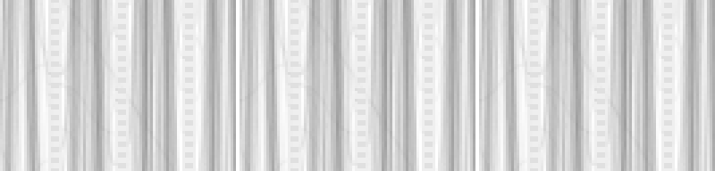

# Bézier detail and the first reconnect on a large graph

On Nirvana Max, the selected implementation reduced first reconnects with a frame interval over 16.7 ms from **35 of 48 to 2 of 48**. Canvas had **48 of 48**. Backend draw p95 fell from **56.8 to 17.6 ms** and edit-to-rAF p95 from **70.0 to 25.5 ms**. On ETL 10k/10k, reconnect draw p95 was **15.1 ms**, with two long windows in 48 edits. Draw duration on Nirvana and input latency on both fixtures still cross the 16.7 ms target at p95.

The previous renderer could move megabytes of unrelated curve records when one connection changed endpoints. Its adaptive curve source kept its records densely packed. The revised layout classifies each opaque curve piece from its own geometry and retains physical addresses in both curve sources. A change in the number of pieces can now reuse holes or grow the edited range without compacting other owners. [Previous mixed-pass measurements](2026-11-18-nirvana-mixed-reconnect.md) · [Raw samples and frozen build hashes, compressed JSON](2026-11-18-bezier-detail-reconnect.json.gz)

## Final comparison of the selected renderer

D is the previous renderer (`208b3db8a2e2`). G is the selected build (`b866d0cff47e`), which combines per-piece Bézier detail, retained opaque curve sources and local culling-bound updates. The three workloads below ran in fresh D/G/Canvas/Canvas/G/D order on the same hardware. Each renderer received 48 measured edits per workload. Every long interval in this table occurred in a separate edit window. The three p95 values in each timing column follow D / G / Canvas order.

| Action | Long intervals / all intervals, D · G · Canvas | rAF gap p95, ms | Backend draw p95, ms | Edit-to-rAF p95, ms |
| --- | ---: | ---: | ---: | ---: |
| Nirvana, first reconnect of distinct connections | 35/642 · 2/765 · 48/645 | 17.2 / 9.3 / 25.0 | 56.8 / 17.6 / 40.1 | 70.0 / 25.5 / 48.7 |
| Nirvana, reconnect/restore the same edge | 13/724 · 9/746 · 48/605 | 9.4 / 9.3 / 32.5 | 24.1 / 19.9 / 53.0 | 36.4 / 31.0 / 64.0 |
| ETL, reconnect/restore a connection | 8/756 · 2/757 · 48/618 | 9.2 / 9.3 / 25.6 | 16.1 / 15.1 / 45.5 | 27.0 / 25.6 / 55.3 |

## What determines curve detail

For a stock solid world-width stroke, the encoder bounds the displacement of the eight-chord strip from its sixteen-chord counterpart, including the antialiasing contour and floating-point allowance. Each qualifying piece enters the adaptive source. All other pieces enter the full-detail source. The earlier layout could preserve a source's previous piece count on reconnect and then choose the most demanding detail across 128 neighboring records. Consequently, moving an unrelated record could change the template used to draw a curve.

The candidate can draw a certified piece with eight chords only while the device scale stays within 0.125 device pixels per world unit and the camera projection fits the error allowance. Translated batches and higher zoom retain sixteen chords. The certificate budgets up to one eighth of a device pixel for geometric displacement. It does not bound the number or intensity of changed framebuffer pixels. Spatial culling still chooses which resident ranges to submit. [Curve certificate and camera guards](../../../packages/graph/src/lib/scene/webgl/curveTessellation.ts)

## Method

The tests use the ETL at Scale story with 10,000 blocks and 10,000 resolved connections and the frozen Nirvana Max fixture with 13,916 blocks and 18,604 resolved connections. Chromium runs on Apple M3 Pro with ANGLE Metal, a 1600 × 1000 CSS-pixel viewport at DPR 2 and MiniMap off. Each WebGL page has one drawing context. The Canvas comparison exercises the Graph Canvas interpreter. Both stories receive the same actions, endpoint choices and camera trajectory in each renderer.

Each edit pass warms eight actions and records 24. In the distinct-connection workload, the 24 first edits target different real connections on the same mounted graph, and the eight warm-up connections are disjoint. Each reconnect keeps the connection ID and source port, changes the destination port and checks the resolved geometry. The repeated workload alternates one reconnect with its restore. ETL also changes a stage and its incident flows, toggles a connection selection, moves a connected block and drags a 19-block group. Camera passes warm 48 movements and record 100 consecutive pan or zoom updates.

A long interval exceeds 16.700 ms after rounding the rAF gap to the nearest microsecond. An edit window spans input, a 120 ms settling period and two rAF callbacks. One window may contain several long intervals. Draw duration measures synchronous work in the WebGL backend or Canvas interpreter. Input-to-rAF includes the time between the edit and its callback. Percentiles use the nearest rank. The phase-instrumented runs are separate from latency measurements.

## Retained curve sources against the previous renderer and Canvas

This comparison ran Canvas/D/E/E/D/Canvas on frozen builds, with two independent passes for each renderer. D is the previous renderer, `208b3db8a2e2`, and E is the homogeneous-source implementation, `074dc2609fc0`. Each of the three counts in the second column has 48 edit windows. Timing columns use the same D / E / Canvas order.

| Story and action | Windows with a long interval, D / E / Canvas | Draw p95, ms | Input-to-rAF p95, ms |
| --- | ---: | ---: | ---: |
| Nirvana, first reconnect of distinct connections | 33 / 1 / 48 | 49.4 / 19.0 / 64.1 | 59.6 / 28.2 / 72.9 |
| Nirvana, reconnect/restore the same edge | 4 / 3 / 48 | 12.6 / 13.6 / 51.9 | 27.9 / 28.2 / 60.2 |
| Nirvana, select/deselect a connection | 32 / 17 / 48 | 19.9 / 14.8 / 47.3 | 38.4 / 33.5 / 57.2 |
| Nirvana, move a connected block | 0 / 0 / 48 | 8.6 / 9.4 / 50.9 | 18.7 / 19.0 / 59.6 |
| ETL, reconnect/restore a connection | 11 / 12 / 48 | 19.6 / 19.4 / 42.0 | 29.0 / 29.3 / 52.4 |
| ETL, select/deselect a connection | 3 / 1 / 48 | 5.6 / 4.2 / 41.5 | 24.7 / 22.9 / 50.3 |
| ETL, change a stage and its incident flows | 15 / 6 / 48 | 23.0 / 21.1 / 42.4 | 32.5 / 29.8 / 51.0 |
| ETL, move a connected block | 1 / 1 / 48 | 9.0 / 9.0 / 41.8 | 23.2 / 21.9 / 51.5 |
| ETL, drag a group of 19 blocks | 34 / 26 / 48 | 28.4 / 21.7 / 42.8 | 42.4 / 35.0 / 59.2 |

For first-time reconnects the measured long intervals were **33/658 on D, 1/766 on E and 48/574 on Canvas**. Repeating an edit on the same connection already avoided the large adaptive upload in D. On ETL, reconnect draw p95 changed by 0.2 ms, and one more window contained a long interval. The workloads with a clearer ETL improvement were stage updates and group drag.

The camera changed no path geometry. WebGL recorded zero source encodes and zero path-record upload bytes on all four movements in both builds. Each renderer recorded 200 frames per movement.

| Camera movement | Long intervals / 200, D / E / Canvas | rAF gap p95, ms, in the same order |
| --- | ---: | ---: |
| Nirvana, circular pan at fit | 34 / 40 / 186 | 24.9 / 17.6 / 33.4 |
| Nirvana, fit to 0.95 and back | 9 / 8 / 70 | 16.7 / 16.7 / 41.8 |
| ETL, circular pan at fit | 0 / 0 / 183 | 9.3 / 9.3 / 42.2 |
| ETL, fit to 0.95 and back | 11 / 11 / 38 | 17.0 / 16.8 / 25.5 |

## Does a more general plan repair help?

E keeps the existing resize operation and uses the full mixed planner if the edited primitive gains or loses a rendering source. F added a replacement at the primitive's previous painter position. It guarded ownership, unchanged surrounding visibility, widths, source bindings and destination collisions. On the same 24 distinct geometry changes, an instrumented version of E repaired 22 schedules and rebuilt two. F repaired all 24. Both skipped the root-depth traversal on every reconnect. For the 16 repeated edits, both repaired every schedule.

A separate E/F/F/E timing run used the frozen bundles `074dc2609fc0` and `7a779830f2e8`. Each variant received 48 edit windows. The elapsed frame times favored the simpler planner, so the source-membership repair was removed from the worktree.

| Distinct Nirvana reconnects | E, existing repair | F, extended repair |
| --- | ---: | ---: |
| Long intervals / all intervals | 4 / 763 | 9 / 737 |
| Windows with a long interval / 48 | 4 | 9 |
| Backend draw p50 / p95, ms | 12.5 / 19.8 | 17.25 / 21.2 |
| Input-to-rAF p50 / p95, ms | 21.95 / 30.1 | 26.45 / 30.5 |

In a separate diagnostic run, median path-record writes on the 24 first reconnects fell from 8,942,000 bytes in D to 7,840 bytes with independently classified retained sources. The median packed-address write fell from 1,253,584 to 479,318 bytes. The single contiguous stream of four-byte record IDs can still shift after a change in its middle. These write counts concern the sampled connections. They do not predict the cost of changing an arbitrary graph or window.

## Local refresh of culling bounds

G retains E's curve sources and planner. When a path or origin changes at a stable camera scale, it updates the visibility bounds of the changed physical chunks. It tracks how many selected chunks contain translated geometry, which determines whether coarse curves can use their certificate. A full invalidation, a relevant level change or a crossing of the saved scale boundaries still selects every hull. Removing a scale boundary can cause an earlier full refresh. [Chunk invalidation and scale selection](../../../packages/graph/src/lib/scene/webgl/pathCulling.ts)

On 24 instrumented first reconnects, the two builds regenerated the same 115 dirty chunks. E visited 73,227 chunk bounds while selecting visible hulls, a median of 3,051 per edit. G selected 115 bounds in total, a median of five and a range of three to six. Median total time in the batch culling updates fell from 2.60 to 0.40 ms. The enclosing path-upload phase fell from 3.40 to 0.95 ms. These measurements describe the work removed inside the backend.

An independent E/G/G/E run recorded two passes per variant. It isolates the culling change from the retained-source change. Each action had 48 edit windows per build.

| Action | Long intervals, E → G | Draw p95, ms, E → G | Input-to-rAF p95, ms, E → G |
| --- | ---: | ---: | ---: |
| Nirvana, first reconnects on distinct connections | 5/759 → 3/761 | 25.9 → 25.9 | 35.6 → 34.5 |
| Nirvana, repeated reconnect | 5/755 → 2/757 | 12.8 → 10.9 | 29.1 → 27.0 |
| ETL, repeated reconnect | 12/726 → 13/726 | 21.2 → 20.4 | 32.1 → 31.2 |
| ETL, change a stage and its incident flows | 21/726 → 17/729 | 22.9 → 22.2 | 32.9 → 31.6 |
| ETL, drag 19 grouped blocks | 42/670 → 38/684 | 29.4 → 29.6 | 43.9 → 44.1 |

The two E observations for distinct first reconnects in the E/F and E/G experiments illustrate hardware-run variation. Draw p95 was 19.8 ms in one and 25.9 ms in the other. Each comparison uses its own matched control.

The paired E/G camera runs had zero geometry encodes and zero path-record upload bytes on both builds. For each 200-frame trajectory, ETL pan had 0/0 long intervals and zoom 13/11. Nirvana pan had 77/45 and zoom 14/14. A separate deterministic CPU comparison checked 1,920 updates against E, including range edits, origin movement and camera/level changes. The incremental and full selectors produced the same partial ranges and prepared ranges throughout.

Across 24 first-time and 16 repeated reconnects, G and E produced identical diagnostic draw calls, submitted instance counts, packed ranges, command counts and source bytes for every edit. G repaired 22 of the 24 first edits and rebuilt two.

The allocator test made **1,560 confirmed edits**: the first 24 reconnects followed by 32 cycles of 24 restores and 24 reconnects. Both opaque curve sources retained their original CPU-buffer capacities and GPU-texture dimensions throughout. The adaptive source peaked at 207,383 physical slots and 330 holes. After the seventh cycle it alternated between 207,359 and 207,367 slots at the end of each reconnect phase, with 207,197 live records. The regular source peaked at 145,963 slots and 151 holes. Its final phases alternated between 145,961 and 145,962 slots, with 145,849 live records.

## Image comparisons

The frozen E build matched the previous D framebuffer on all 54 standard frames, including HTML card and anchor metadata on 12 detailed ETL captures. On the 24 cumulative first reconnects at Nirvana fit scale, E differed from D on 32–61 of 6.4 million physical pixels per image, totalling 1,342 pixel observations. The four additional close-ups matched. Across 22 scales/poses, 12 frames matched and ten changed, with at most 252 differing pixels in a frame. Every changed red, green, blue or alpha channel differed by just one step in an 8-bit channel. Two separately isolated, untouched neighboring connections retained their images.

Two controls used the 28 edit images and 22 zoom poses. Forcing sixteen chords and disabling overview grouping in both builds yielded **50/50 exact D/E images**. Forcing a fresh mixed plan in E yielded **50/50 exact images** against ordinary E. Normal overview rendering still groups eligible sequences of two adaptive or four regular records into a single overview primitive. Against its own ungrouped sixteen-chord reference, E changed 1,243,111 pixel observations across the 28 edit images, compared with 1,242,071 for D. The largest per-channel difference against that reference was two levels in alpha across the edit images and three across the zoom poses. Those controls exercise both grouping and tessellation. The prior layout's dependence on adjacent records explains why ordinary rendering can differ even when the complete sixteen-chord images agree.

An independent geometric check compared the boundaries and interior of the eight- and sixteen-chord stroke strips on **545,771 visible eight-chord occurrences** over three camera poses. The largest observed displacement was **0.05684 device pixels** in both builds. Every sampled strip stayed within the 0.125-pixel budget, and every checked pose above the device-scale threshold selected sixteen chords.

The thirteenth first-time reconnect (index 12) at Nirvana fit scale changed 61 physical pixels between E and D across the full framebuffer. The panels show the same 88 × 64 physical pixels near x = 1542, y = 1888, enlarged threefold. From left to right they show the previous D image, the revised WebGL image, and a control that forces sixteen chords and disables overview grouping.

G matched E on all **104** visual checks covering both stories and all tested scales: 54 standard captures, 28 first-edit and close-up captures, and 22 further zoom poses. The local visibility-bound update preserved the images from the independently classified sources.

## Verification

The Graph unit suite passed **2,035 tests** across 195 suites with six existing todos and nine passing snapshots. Workspace build and type checking, the browser-test bundle and scoped formatting passed. Scoped lint reported nine warnings and zero errors. All **128 Chromium–Metal end-to-end checks passed in 57.64 seconds**, including the public reconnect and restore pixel check. There were zero skipped, unexpected or flaky cases.

The archived replay sources for D, E and G were extracted and rebuilt. All three bundle hashes matched the frozen benchmarks. The complete replay archive has SHA-256 `aac838fae26d159ee355c8f9a7ea2b28b732e471ba4dea4c259eff56323e613d`. [Replay and allocator evidence](2026-11-18-bezier-detail-reconnect.json.gz)
