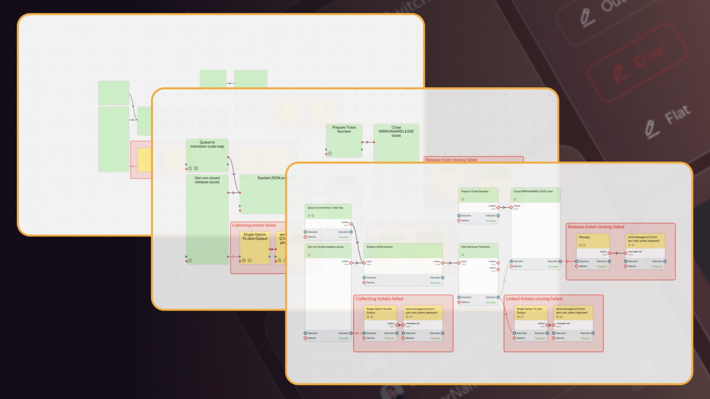

# @gravity-ui/graph &middot; [](https://www.npmjs.com/package/@gravity-ui/graph) [](https://github.com/gravity-ui/graph/actions/workflows/release.yml?query=branch:main) [](https://preview.gravity-ui.com/graph/v2/)

> [Переход с 1.x на 2.x](docs/migration-guides/v1-to-v2.md) · [Переход с 0.x на 1.x](docs/migration-guides/v0-to-v1.md)

Редактор блок-схем, пайплайнов и других графов. Блоки, якоря и штатные связи рисуются в общей сцене.
По умолчанию сцена использует Canvas 2D. Чтобы рисовать её в одном контексте WebGL2, задай `settings: { renderer: "webgl" }`.



## Как это работает

При изменении масштаба сцена переключается между минималистичным, схематичным и детальным представлениями.
На детальном уровне `GraphCanvas` с функцией `renderBlock` создаёт React-компоненты для видимых блоков.
`GraphBlock` передаёт отрисовку в HTML после монтирования компонента. Связи, их стрелки и подписи остаются
в сцене. Подробнее в [руководстве по сцене](docs/system/scene.md) и [описании перехода в HTML](docs/react/usage.md#the-handover-to-html).

[Storybook](https://preview.gravity-ui.com/graph/v2/)

## Установка

Чтобы установить версию с API сцены из этой ветки, собери и упакуй ядро из корня репозитория.

```bash
pnpm install --frozen-lockfile
pnpm run build
pnpm --dir packages/graph pack
```

Установи полученный `.tgz` в приложении командой `npm install <путь-к-архиву>`. Для React также упакуй `packages/graph-react` из той же рабочей копии и установи оба архива вместе. Потребуются React 18 и React DOM 18. [Каналы выпуска v2](docs/v1-v2-transition.md#before-cutover).


## Примеры

### Пример на React

[Подробная документация по React компонентам](docs/react/usage.md)

```tsx
import React, { useEffect } from "react";
import type { Graph, TBlock } from "@gravity-ui/graph";
import { EAnchorType } from "@gravity-ui/graph";
import { GraphCanvas, GraphBlock, GraphBlockAnchor, useGraph } from "@gravity-ui/graph-react";
import "@gravity-ui/graph/styles.css";
import "@gravity-ui/graph-react/styles.css";

const config = {};

export function GraphEditor() {
  const { graph, setEntities, start } = useGraph(config);

  useEffect(() => {
    setEntities({
      blocks: [
        {
          is: "block-action",
          id: "action_1",
          x: -100,
          y: -450,
          width: 126,
          height: 126,
          name: "Block #1",
          anchors: [
            {
              id: "out1",
              blockId: "action_1",
              type: EAnchorType.OUT,
              index: 0,
            },
          ],
        },
        {
          id: "action_2",
          is: "block-action",
          x: 253,
          y: 176,
          width: 126,
          height: 126,
          name: "Block #2",
          anchors: [
            {
              id: "in1",
              blockId: "action_2",
              type: EAnchorType.IN,
              index: 0,
            },
          ],
        },
      ],
      connections: [
        {
          sourceBlockId: "action_1",
          sourceAnchorId: "out1",
          targetBlockId: "action_2",
          targetAnchorId: "in1",
        },
      ],
    });
    start();
    graph.runAfterGraphReady(() => graph.zoomTo("center", { padding: 300 }));
  }, [graph, setEntities, start]);

  const renderBlockFn = (graph: Graph, block: TBlock) => {
    return (
      <GraphBlock graph={graph} block={block}>
        {block.name}
        {block.anchors?.map((anchor) => (
          <GraphBlockAnchor key={anchor.id} graph={graph} anchor={anchor} position="absolute" />
        ))}
      </GraphBlock>
    );
  };

  return <GraphCanvas graph={graph} renderBlock={renderBlockFn} />;
}
```

### Пример на JavaScript

```javascript
import { Graph } from "@gravity-ui/graph";
import "@gravity-ui/graph/styles.css";

// Создаем контейнер
const container = document.createElement('div');
container.style.width = '100vw';
container.style.height = '100vh';
container.style.overflow = 'hidden';
document.body.appendChild(container);

// Инициализируем граф с конфигурацией
const graph = new Graph({
    configurationName: "example",
    blocks: [],
    connections: [],
    settings: {
        canDragCamera: true,
        canZoomCamera: true,
        useBezierConnections: true,
        showConnectionArrows: true
    }
}, container);

// Добавляем блоки и связи
graph.setEntities({
    blocks: [
        {
            is: "block-action",
            id: "block1",
            x: 100,
            y: 100,
            width: 120,
            height: 120,
            name: "Блок #1"
        },
        {
            is: "block-action",
            id: "block2",
            x: 300,
            y: 300,
            width: 120,
            height: 120,
            name: "Блок #2"
        }
    ],
    connections: [
        {
            sourceBlockId: "block1",
            targetBlockId: "block2"
        }
    ]
});

// Запускаем отрисовку
graph.start();

// Центрируем вид
graph.runAfterGraphReady(() => graph.zoomTo("center", { padding: 100 }));
```

## Демо

- [Базовый пример](https://preview.gravity-ui.com/graph/?path=/story/stories-main-grapheditor--hundred-blocks)
- [Пример с большим количеством элементов](https://preview.gravity-ui.com/graph/?path=/story/stories-main-grapheditor--five-thousands-blocks)
- [Кастомизация блоков](https://preview.gravity-ui.com/graph/?path=/story/stories-main-grapheditor--custom-schematic-block)
- [Кривые Безье](https://preview.gravity-ui.com/graph/?path=/story/stories-main-grapheditor--one-bezier-connection)
- [Настройка связей](https://preview.gravity-ui.com/graph/?path=/story/api-updateconnection--default)

## Документация

### Основные концепции

| Раздел | Описание | Документация |
|--------|-----------|--------------|
| Сцена | Выбор рендерера, уровни детализации и порядок отрисовки | [Подробнее](docs/system/scene.md) |
| Теги и стили | Оформление состояний и отдельных частей блоков и связей | [Подробнее](docs/system/tags-and-styles.md) |
| Жизненный цикл компонентов | Инициализация, обновление, отрисовка и удаление компонентов | [Подробнее](docs/system/component-lifecycle.md) |
| Механизм отрисовки | Процесс отрисовки и оптимизации | [Подробнее](docs/rendering/rendering-mechanism.md) |
| Система событий | Обработка и распространение событий | [Подробнее](docs/system/events.md) |

### Основные компоненты

| Компонент | Описание | Документация |
|-----------|-----------|--------------|
| Canvas Graph | Основа для визуальных элементов с системой обнаружения | [Подробнее](docs/components/canvas-graph-component.md) |
| Block Component | Базовые блоки для узлов графа | [Подробнее](docs/components/block-component.md) |
| Connections | Создание и стилизация связей | [Подробнее](docs/connections/canvas-connection-system.md) |
| Линии связей и WebGL | Линии, геометрия, рендерер WebGL и эффекты | [Подробнее](docs/connections/webgl-connections.md) |

### Дополнительные возможности

| Возможность | Описание | Документация |
|-------------|-----------|--------------|
| Система слоев | Управление z-index и отрисовка по слоям | [Подробнее](docs/rendering/layers.md) |
| Группы блоков | Автоматическая и ручная группировка | [Подробнее](docs/blocks/groups.md) |
| Планировщик | Управление кадрами и приоритетами обновлений | [Подробнее](docs/system/scheduler-system.md) |

### Конфигурация

| Тема | Описание | Документация |
|------|-----------|--------------|
| Настройки графа | Параметры конфигурации | [Подробнее](docs/system/graph-settings.md) |
| API | Методы для управления графом | [Подробнее](docs/system/public_api.md) |

### Тестирование

- [Page object-ы для Playwright](https://github.com/gravity-ui/graph/blob/v2/packages/graph-playwright/README.md)
