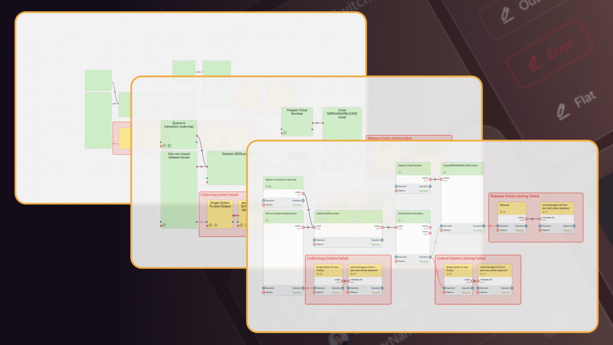

# @gravity-ui/graph &middot; [](https://www.npmjs.com/package/@gravity-ui/graph) [](https://github.com/gravity-ui/graph/actions/workflows/release.yml?query=branch:main) [](https://preview.gravity-ui.com/graph/v2/)

> [Migration Guide from 1.x to 2.x →](docs/migration-guides/v1-to-v2.md)
>
> [Migration Guide from 0.x to 1.x →](docs/migration-guides/v0-to-v1.md)

A framework-independent editor for flowcharts, pipelines and other node-based diagrams.
Blocks, anchors and built-in connections share one scene. It draws with Canvas 2D by default.
Set `settings.renderer` to `"webgl"` to draw the same scene in one WebGL2 context.



## How It Works

The scene draws the minimalistic, schematic and detailed views as the camera zooms.
At the detailed level you can supply `renderBlock` to `GraphCanvas` to mount React views for visible blocks.
`GraphBlock` hands drawing over to its HTML view when it mounts. Connections continue to draw in the scene,
including their arrows and labels. See the [scene guide](docs/system/scene.md) and the
[React handover guide](docs/react/usage.md#the-handover-to-html).

[Storybook](https://preview.gravity-ui.com/graph/v2/)

## Install

To install the scene API from this branch, build and pack the core package from the repository root.

```bash
pnpm install --frozen-lockfile
pnpm run build
pnpm --dir packages/graph pack
```

Install the resulting `.tgz` in your application with `npm install <path-to-tarball>`. For React, also pack `packages/graph-react` from the same checkout, install both tarballs together, and use React 18 and React DOM 18. See the [v2 release channels](docs/v1-v2-transition.md#before-cutover).

### TypeScript

Published declarations are built and checked with TypeScript 6.0 (`strict: true`, `skipLibCheck: false`;
Bundler, Node16 ESM and Node16 CommonJS consumers). Other TypeScript versions are not tested.


## Usage

### React Example

[Detailed React Components Documentation](docs/react/usage.md)

```tsx
import React, { useEffect } from "react";
import type { Graph, TBlock } from "@gravity-ui/graph";
import { EAnchorType } from "@gravity-ui/graph";
import { GraphCanvas, GraphBlock, GraphBlockAnchor, useGraph } from "@gravity-ui/graph-react";
import "@gravity-ui/graph/styles.css";
import "@gravity-ui/graph-react/styles.css";

const config = {};

export function GraphEditor() {
  const { graph, setEntities, start } = useGraph(config);

  useEffect(() => {
    setEntities({
      blocks: [
        {
          is: "block-action",
          id: "action_1",
          x: -100,
          y: -450,
          width: 126,
          height: 126,
          name: "Block #1",
          anchors: [
            {
              id: "out1",
              blockId: "action_1",
              type: EAnchorType.OUT,
              index: 0,
            },
          ],
        },
        {
          id: "action_2",
          is: "block-action",
          x: 253,
          y: 176,
          width: 126,
          height: 126,
          name: "Block #2",
          anchors: [
            {
              id: "in1",
              blockId: "action_2",
              type: EAnchorType.IN,
              index: 0,
            },
          ],
        },
      ],
      connections: [
        {
          sourceBlockId: "action_1",
          sourceAnchorId: "out1",
          targetBlockId: "action_2",
          targetAnchorId: "in1",
        },
      ],
    });
    start();
    graph.runAfterGraphReady(() => graph.zoomTo("center", { padding: 300 }));
  }, [graph, setEntities, start]);

  const renderBlockFn = (graph: Graph, block: TBlock) => {
    return (
      <GraphBlock graph={graph} block={block}>
        {block.name}
        {block.anchors?.map((anchor) => (
          <GraphBlockAnchor key={anchor.id} graph={graph} anchor={anchor} position="absolute" />
        ))}
      </GraphBlock>
    );
  };

  return <GraphCanvas graph={graph} renderBlock={renderBlockFn} />;
}

```

### Vanilla JavaScript Example

```javascript
import { EAnchorType, Graph } from "@gravity-ui/graph";
import "@gravity-ui/graph/styles.css";

// Create container element
const container = document.createElement('div');
container.style.width = '100vw';
container.style.height = '100vh';
container.style.overflow = 'hidden';
document.body.appendChild(container);

// Initialize graph with configuration
const graph = new Graph({
    configurationName: "example",
    blocks: [],
    connections: [],
    settings: {
        canDragCamera: true,
        canZoomCamera: true,
        useBezierConnections: true,
        showConnectionArrows: true
    }
}, container);

// Add blocks and connections
graph.setEntities({
    blocks: [
        {
            is: "block-action",
            id: "block1",
            x: 100,
            y: 100,
            width: 120,
            height: 120,
            name: "Block #1",
            anchors: [
                {
                    id: "out1",
                    blockId: "block1",
                    type: EAnchorType.OUT,
                    index: 0
                }
            ]
        },
        {
            is: "block-action",
            id: "block2",
            x: 300,
            y: 300,
            width: 120,
            height: 120,
            name: "Block #2",
            anchors: [
                {
                    id: "in1",
                    blockId: "block2",
                    type: EAnchorType.IN,
                    index: 0
                }
            ]
        }
    ],
    connections: [
        {
            sourceBlockId: "block1",
            sourceAnchorId: "out1",
            targetBlockId: "block2",
            targetAnchorId: "in1"
        }
    ]
});

// Start rendering
graph.start();

// Center the view
graph.runAfterGraphReady(() => graph.zoomTo("center", { padding: 100 }));
```

## Live Examples

- [Basic example](https://preview.gravity-ui.com/graph/?path=/story/stories-main-grapheditor--hundred-blocks)
- [Large scale example](https://preview.gravity-ui.com/graph/?path=/story/stories-main-grapheditor--five-thousands-blocks)
- [Custom blocks view](https://preview.gravity-ui.com/graph/?path=/story/stories-main-grapheditor--custom-schematic-block)
- [Bezier connection](https://preview.gravity-ui.com/graph/?path=/story/stories-main-grapheditor--one-bezier-connection)
- [Connection customization](https://preview.gravity-ui.com/graph/?path=/story/api-updateconnection--default)

## Documentation

### Table of Contents

1. System
   - [Component Lifecycle](docs/system/component-lifecycle.md)
   - [Events](docs/system/events.md)
   - [Graph Settings](docs/system/graph-settings.md)
   - [Public API](docs/system/public_api.md)
   - [Scheduler System](docs/system/scheduler-system.md)
   - [Scene](docs/system/scene.md)
   - [Add and update a custom scene element](docs/system/scene.md#add-an-element-to-the-scene)
   - [Tags and styles](docs/system/tags-and-styles.md)
   - [WebGL scene effect types](docs/system/scene-effects.md)

2. Components
   - [Canvas Graph Component](docs/components/canvas-graph-component.md)
   - [Block Component](docs/components/block-component.md)
   - [Anchors](docs/components/anchors.md)

3. Rendering
   - [Rendering Mechanism](docs/rendering/rendering-mechanism.md)
   - [Layers](docs/rendering/layers.md)

4. Blocks and Connections
   - [Block Groups](docs/blocks/groups.md)
   - [Canvas Connection System](docs/connections/canvas-connection-system.md)
   - [Connection lines, geometry and effects](docs/connections/webgl-connections.md)
   - [Batch Rendering](docs/connections/batch-rendering.md)

5. Testing
   - [Playwright page objects](https://github.com/gravity-ui/graph/blob/v2/packages/graph-playwright/README.md)

## License

Distributed under the MIT License. See [LICENSE](LICENSE) for details.

## For AI agents

Use the core package to display and edit node-based diagrams. The optional React package adds HTML block views.

### When to use

- Node-based editors (flowcharts, pipelines, visual builders) with hundreds/thousands of nodes and connections.
- Canvas 2D or WebGL for the graph with optional React block views at the detailed level.
- Vanilla JS or React consumers — the core `Graph` class is framework-agnostic; `@gravity-ui/graph-react` provides the React bindings.

### When not to use

- To plot numeric data series (line/bar/scatter charts), use [`@gravity-ui/charts`](https://gravity-ui.com/charts) or [`@gravity-ui/yagr`](https://github.com/gravity-ui/yagr) — graph is a node/edge diagram editor, not a data chart.
- For a static, non-editable diagram with few nodes, an SVG or a simpler diagram lib may suffice without the Canvas/React viewport machinery.

### Common pitfalls

- **Hallucinated import `GraphEditor`** — the React components are `GraphCanvas`, `GraphBlock`, and the `useGraph` hook, imported from `@gravity-ui/graph-react`; the core class is `Graph` from `@gravity-ui/graph`.
- **Fitting a newly loaded graph** — call `graph.runAfterGraphReady(() => graph.zoomTo("center"))` after `start()` to fit the first registered block bounds.
- **Replacing graph data** — pass both collections to `setEntities({ blocks, connections })` for a full snapshot. Use `updateEntities` to patch individual blocks or connections.
- **Choosing endpoints** — supply block IDs for a block-to-block connection, add anchor IDs to connect specific anchors, or supply explicit port IDs. See [connection geometry](docs/connections/webgl-connections.md).

## Documentation for AI agents

Agent-readable documentation for the installed version is located in `node_modules/@gravity-ui/graph/build/docs/INDEX.md`.
