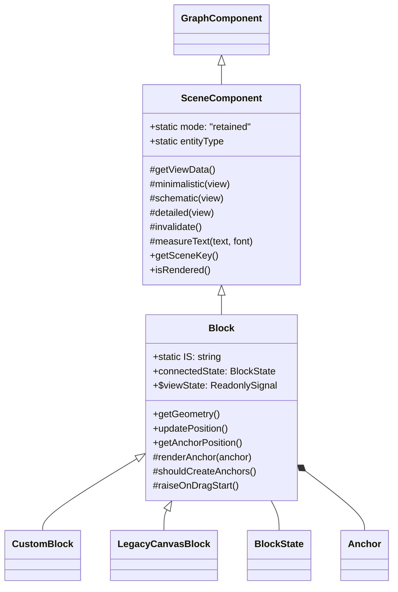

# Block Component

`CanvasBlock` (the `Block` class) is the canvas component of a graph block. It is a scene component: `graph.scene`
draws it on the scene canvas, with Canvas 2D or WebGL, from primitives that its level methods return, and tags and
style rules paint its parts. `GraphLayer` stays its parent: the block receives events, is hit-tested and is dragged
there. Its anchors are [`Anchor`](anchors.md) components that draw as child elements of the block's element.



## Data and props

```typescript
type TBlock<T extends Record<string, unknown> = {}> = {
  id: TBlockId;              // Unique identifier
  is: string;                // Block type: the key of its component in `blockComponents`
  x: number;
  y: number;
  group?: string;
  width: number;
  height: number;
  name: string;              // The title
  anchors?: TAnchor[];       // Connection points
  settings?: TBlockSettings;
  meta?: T;                  // Custom data
};

type TBlockProps = TGraphComponentProps & {
  id: TBlockId;
  font?: string;             // Read by LegacyCanvasBlock's renderText only
};
```

Selection is not block data: read it with `connectedState.$selected` or `selectedTag` (see
[Tags and styles](../system/tags-and-styles.md)). The component state is the block data only.

## Scene components

`SceneComponent` is the base class of components that the scene draws. It owns one scene element, or one child element
of its parent's element (an anchor).

- **`static override readonly mode = "retained"`** (the default of `SceneComponent`): the frame walk never visits the component. When an
  input of its element changes, it queues an update, and its tree applies it before painting (see
  [Component lifecycle](../system/component-lifecycle.md#7-scene-components)). Unchanged blocks cost a frame nothing.
  `static override readonly mode = "immediate"` puts a class back into the walk: its update then runs every frame, and its `render()`
  draws on its layer's canvas.
- **`static entityType`** (`"block"`, `"anchor"`) is the type of its tag address and the prefix of its element id. The
  element is styled by the tags of `(entityType, getEntityId())`.
- Children of a retained component must be retained, or mounting them throws: a block that draws child components in
  `render()` extends [`LegacyCanvasBlock`](#legacycanvasblock).

## View data

`getViewData()` returns the inputs of the level methods. `Block`'s is `TBlockView<T>`: the block data without `x` and
`y`, plus `look` (`TBlockLook`: `fontSize`, `padding`, `borderWidth` and `textMinScale`, from the graph constants and
`scaleFontSize`).

- It is read inside a `computed`, so the signals it reads are tracked: a change of the block's `$state` or of the
  constants reads it again. It is also read again after new props and after `invalidate()`.
- Return a fresh object on every call. Development builds freeze its top level, so returning an object that something
  else owns would freeze that object.
- The new view is compared with the last one (`sameView`): the same keys, each value equal by identity or, for plain
  objects and arrays (`meta`, `anchors`), one level deep. Equal views keep the last object, and the level methods do
  not run again, so code that rebuilds `meta` with equal values on every update re-runs nothing. A hole in a sparse
  array compares as `undefined`.
- `x` and `y` are not view data: a move writes the element's origin only (`getSceneOrigin()` reads the block's
  `$state`), and re-encodes nothing.

A subclass adds its own view data by widening `getViewData()` and the `view` of its level methods:

```typescript
import { CanvasBlock } from "@gravity-ui/graph";
import type { TBlockView, TScenePrimitive } from "@gravity-ui/graph";

type TSubtitledView = TBlockView & { subtitle: string };

class SubtitledBlock extends CanvasBlock {
  protected override getViewData(): TSubtitledView {
    return { ...super.getViewData(), subtitle: `#${this.props.id}` };
  }

  protected override schematic(view: TSubtitledView): readonly TScenePrimitive[] {
    const subtitle: TScenePrimitive = {
      kind: "text",
      part: "title",
      text: view.subtitle,
      family: "sans-serif",
      size: 12,
      lineHeight: 14,
      x: 8,
      y: view.height - 22,
      width: view.width - 16,
    };
    return [...super.schematic(view), subtitle];
  }
}
```

## Level methods

`minimalistic(view)`, `schematic(view)` and `detailed(view)` return the block's look on each [scene
level](../system/scene.md#level) as `readonly TScenePrimitive[]` (rects, circles, text, icons, paths, polygons), in
world units relative to the block's origin (its `x`, `y`). Do not transform coordinates: the scene applies the
origin and the camera.

- They run in the block's queued update, in the frame, and only when the view data changed or after `invalidate()`.
  Normally that is once per frame; a parent's reconciliation can apply a retained child again in the same frame, and
  an export can apply updates synchronously outside a frame.
- A level without its own method takes the schematic list, else the minimalistic one, else the detailed one.
- All levels are encoded into one element, and each primitive is drawn only on the levels that returned it, so a level
  change needs no re-encode of its own (a level-scoped style rule that changes the result still re-encodes). A
  primitive returned by several levels (the same object, or an equal one) is usually encoded once; the merge keeps each
  level's primitive order and reuses a match only at or after its cursor, so levels that return the same primitives
  in a different order encode some of them twice.
- Output equal to the last one (by value, three levels deep) keeps the written array, so nothing is re-encoded.
- Leave paints unset to take the theme's colours (a `body` rect without `fill` takes `colors.block.background`); a
  paint that no primitive and no rule sets draws nothing.
- Camera-aware sizes and `minScale` / `maxScale` adapt a look to zoom. A stroke width `{ px, minWorld, maxWorld }`
  keeps its screen width; a text with `cameraAware` (`true` or `{ minWorld, maxWorld }`) keeps its `size` in screen
  pixels and re-fits its box as the camera zooms, as v1's `9 / scale` fonts did (see
  [Text primitives](../system/scene.md#text-primitives)). Both renderers clip a text to its box, so a text with a
  `height` keeps the element's bounds at its box. A `px` stroke width without `maxWorld`, or a heightless camera-aware
  text without `maxWorld`, makes the bounds take its size at the minimum camera scale (development warning).
- A part style's `cameraAware` changes the mode of the part's texts, and the `cameraAwareText` setting turns every
  text off: hand the mode to a block type with a rule (`{ target: MyBlock, style: { parts: { title: { cameraAware: true
  } } } }`), not with a second look.

### The default look

`Block` defines two level methods:

- `schematic(view)`: the halo, the body, the border, the title and the badge;
- `detailed(view)`: the same without the title (a React graph shows its HTML blocks at that level; handing the
  canvas look over to them is a later step).

`Block` defines no `minimalistic`: that level takes the schematic list, as `renderMinimalisticBlock` drew
`renderSchematicView` before. A subclass that overrides only `schematic` therefore changes both levels with one list.
`super.minimalistic(view)` does not exist: call `super.schematic(view)`.

| Part | Primitive |
| --- | --- |
| `halo` | rect 12 world units outside the block, radius 12; hidden by the theme |
| `body` | the block's rect |
| `border` | the block's rect with an inside border of `{ px: BORDER_WIDTH, minWorld: BORDER_WIDTH, maxWorld: 10 }` |
| `title` | `name`, bold sans-serif at `text.BASE_FONT_SIZE × scaleFontSize` (world units), line pitch the font size, wrapped and kept in the block inset by `text.PADDING`, centred horizontally at the top, from `block.SCALES[0]` on |
| `badge` | circle of radius 8, 16 world units from the top-right corner; hidden by the theme |

The five primitives are shared between the two levels, so each is encoded once. Style them with rules (see
[Default block and anchor parts](../system/tags-and-styles.md#default-block-and-anchor-parts)).

### Levels and `block.SCALES`

With the default scale-level strategy, `block.SCALES` `[0.125, 0.225, 0.7]` sets the levels:

- below 0.225: minimalistic; the title shows from 0.125;
- from 0.225: schematic, where anchors are drawn;
- from 0.7: detailed.

```typescript
graph.setConstants({ block: { SCALES: [0.125, 0.225, 0.5] } }); // detailed from 0.5
```

### Purity, `invalidate()` and `measureText`

- Level methods are pure functions of their view data. Read inputs in `getViewData()`. Development builds warn, once
  per class and camera input, when a level method reads the camera (`getCameraScale()`, `getCameraState()`, `getRelative()`).
- `invalidate()` reads the view data again and runs the level methods in the next update, for inputs that are not
  signals. A view data that reads component state (`this.state`) cannot be invalidated from `stateChanged()`: the view
  data is recomputed at once, before the new state is assigned. Call `invalidate()` in `willIterate()`, before
  `super.willIterate()`.
- `this.measureText(text, font)` measures a text in a CSS font for layout in level methods. The component is
  registered with the scene: when late web fonts load (`document.fonts` `loadingdone`), the measures are cleared and
  its level methods run again. A subclass that caches its level output drops the cache in an
  `invalidateTextMeasures()` override that calls `super.invalidateTextMeasures()`.

## Parts and styles

A class declares its part names with the `__styleParts` brand, which `graph.scene.styles.add` checks:

```typescript
import { CanvasBlock } from "@gravity-ui/graph";
import type { TStyleParts } from "@gravity-ui/graph";

class StageBlock extends CanvasBlock {
  public declare readonly __styleParts?: TStyleParts<"body" | "border" | "title" | "halo" | "badge" | "progress">;
}
```

The theme colours the body, border and title, hides the halo and the badge, and gives a selected block the
`selectedBorder` colour. A new look that needs structure (a status icon) is a part the class draws, hidden by a base
rule and shown by a state rule. At most 15 distinct part names exist in a scene.

## Order, selection and drag

- A block's element is in bucket `block.DEFAULT_Z_INDEX` (200). The theme raises it by 1 while it is selected or
  dragged (bucket 201), and its anchors rise with it.
- Blocks that become selected get new, highest orders in their bucket, in their current scene order, so a group keeps
  its relative order. Deselection keeps the order: the last selected block stays on top of its bucket.
- `handleDragStart` raises the block (`raiseOnDragStart()`) in the default action of `block-drag-start`, so a prevented
  `block-drag-start` does not raise it. The drag service batches the raises of a multi-block drag.
- Hit-testing follows the same order ([`compareOrder`](../system/scene.md#compareorder)): the block drawn on top is hit
  first, and the anchors of a lower block are covered by an upper block.
- The tree `zIndex` and `renderOrder` of a block component do not order scene blocks.
- `$viewState` is a read-only signal for React containers: `{ zIndex: 0, order: rank }`, where `rank` is the dense
  rank, in scene order, among the blocks that React containers show. A container's CSS z-index is `zIndex + order`.

## Hidden blocks

- A block delegated to React (`setRenderDelegated(true)`) hides its element and its anchors' elements; it keeps its
  hit box.
- A block hidden by a collapsed group (`setHiddenBlock(true)`) hides them too, and removes its hit box.
- `isRendered()` is true while the scene draws the block: its element is written, not hidden, and its hit box is in
  the viewport. Its look (the halo, its anchors) can be drawn beyond the hit box, so a block can be partly on screen
  while `isRendered()` is false.

## Lifecycle notes

- An override of `willMount()` must call `super.willMount()`: it creates the element's computeds. Without it the
  element is never written, and development builds log an error.
- A prevented `block-change` does not move a scene block: its origin reads the store.
- See [Component lifecycle](../system/component-lifecycle.md#7-scene-components) for the queued update.

## Anchors

A block creates its [`Anchor`](anchors.md) components lazily, once the camera shows it at a level that draws anchors,
and owns and positions their ports until then.

- `renderAnchor(anchor)` returns one anchor's component descriptor (`ComponentDescriptor<typeof Anchor>`); override it
  to use another class or props. It is a pure function of the block's data: `graph.scene.toImage()` can call it to
  find the anchor classes of a block (see [toImage](../system/scene.md#toimage)).
- `shouldCreateAnchors()` decides when the block creates them; override it to create anchors on other terms.
- `getAnchorPosition(anchor)` returns an anchor's position relative to the block, `getConnectionAnchorPosition(anchor)`
  the absolute one, and `getAnchorPort(anchorId)` its port. `getConnectionPoint("in" | "out")` returns the block's own
  connection points.

## Events

- `click` selects the block (with the meta key, toggles it in the selection).
- `block-drag-start`, `block-drag` and `block-drag-end` are emitted while the block is dragged. Preventing
  `block-drag-start` cancels the drag and its raise; preventing `block-drag` keeps the block in place.

## LegacyCanvasBlock

`LegacyCanvasBlock` is deprecated and kept for one release. It is the block drawn imperatively on the `GraphLayer`
canvas, as before the scene:

- It keeps `render()`, which dispatches by level to `renderMinimalisticBlock(ctx, options)`, `renderSchematicView(ctx,
  options)` and `renderDetailedView(ctx)`, and `renderBody`, `renderStroke`, `renderText`, `shouldRenderText`,
  `willRender`, `calcZIndex`, `raiseBlock` and `getRenderIndex`. A selection raises its tree `zIndex`.
- It is immediate (`static override readonly mode = "immediate"`): the frame walks it and it can have walked children.
- Its scene element has no primitives: it orders and hit-tests the block. The element still takes the block's tags and
  styles (the bucket and hit order they set, and the dim and opacity its anchors inherit), but its imperative body
  drawing ignores scene styles, and it never draws in WebGL.
- It draws under every scene block, because the `GraphLayer` canvas lies under the scene canvas. It is hit in scene
  order, so where it overlaps scene blocks the picture and the hit order can disagree.
- Its anchors draw in the scene, above it.
- `isRendered()` keeps its walk meaning: `shouldRender && isVisible()`.
- The minimap draws it with `renderMinimalisticBlock(ctx, { text: false })`. `toImage()` shows it only in an export of
  the current view.

To keep a v1 block for one release, switch its base class and keep the overrides:

```typescript
import { LegacyCanvasBlock } from "@gravity-ui/graph";

class MyBlock extends LegacyCanvasBlock {
  public override renderSchematicView(ctx: CanvasRenderingContext2D): void {
    ctx.fillStyle = "#FFD700";
    ctx.fillRect(this.state.x, this.state.y, this.state.width, this.state.height);
  }
}
```

In development builds a `CanvasBlock` subclass that defines `render`, `renderBody`, `renderSchematicView`,
`renderMinimalisticBlock`, `renderDetailedView`, `renderStroke` or `renderText` logs one warning per class: these
members never draw on a scene block.

## Registering custom blocks

```typescript
import { CanvasBlock, EAnchorType, Graph } from "@gravity-ui/graph";
import type { TBlockView, TScenePrimitive } from "@gravity-ui/graph";

class GoldBlock extends CanvasBlock {
  protected override schematic(view: TBlockView): readonly TScenePrimitive[] {
    return [
      { kind: "rect", part: "body", x: 0, y: 0, width: view.width, height: view.height, radius: 10, fill: "#FFD700" },
      {
        kind: "rect",
        part: "border",
        x: 0,
        y: 0,
        width: view.width,
        height: view.height,
        radius: 10,
        border: { width: { px: 2, minWorld: 2, maxWorld: 10 }, align: "inside" },
      },
      {
        kind: "text",
        part: "title",
        text: view.name,
        family: "sans-serif",
        size: 13,
        cameraAware: { maxWorld: 60 },
        lineHeight: 16,
        x: 8,
        y: 8,
        width: view.width - 16,
        height: view.height - 16,
        align: "center",
        verticalAlign: "middle",
        color: "#000000",
        minScale: view.look.textMinScale,
      },
    ];
  }
}

const graph = new Graph(
  {
    blocks: [
      {
        id: "block1",
        is: "gold",
        x: 100,
        y: 200,
        width: 180,
        height: 120,
        name: "Gold block",
        anchors: [
          { id: "in", blockId: "block1", type: EAnchorType.IN },
          { id: "out", blockId: "block1", type: EAnchorType.OUT },
        ],
      },
    ],
    settings: { blockComponents: { gold: GoldBlock } },
  },
  rootElement
);
```

`GoldBlock` overrides `schematic` only: the minimalistic level takes the same list, and the detailed level keeps
`Block`'s default look. The `border` part keeps the theme's colours and the selection colour, because it sets no
colour of its own.

The built-in renderer constructs registered block components with `id`, `initialIndex` and `font` only. The registry
type cannot reject classes that declare additional required props, so put custom data into the block's `meta`, or give
extra props defaults in the constructor.
