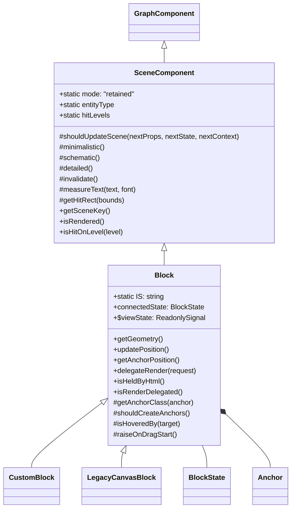

# Block Component

`CanvasBlock` (the `Block` class) is the canvas component of a graph block. It is a scene component: `graph.scene`
draws it on the scene canvas, with Canvas 2D or WebGL, from primitives that its level methods return, and tags and
style rules paint its parts. `GraphLayer` stays its parent: the block receives events, is hit-tested and is dragged
there. Its anchors are [`Anchor`](anchors.md) components that draw as child elements of the block's element.



## Data and props

```typescript
type TBlock<T extends Record<string, unknown> = {}> = {
  id: TBlockId;              // Unique identifier
  is: string;                // Block type: the key of its component in `blockComponents`
  x: number;
  y: number;
  group?: string;
  width: number;
  height: number;
  name: string;              // The title
  anchors?: TAnchor[];       // Connection points
  settings?: TBlockSettings;
  meta?: T;                  // Custom data
};

type TBlockProps = TGraphComponentProps & {
  id: TBlockId;
  font?: string;             // Read by LegacyCanvasBlock's renderText only
};
```

Selection is not block data: read it with `connectedState.$selected` or `selectedTag` (see
[Tags and styles](../system/tags-and-styles.md)). The component state is the block data only.

## Scene components

`SceneComponent` is the base class of components that the scene draws. It owns one scene element, or one child element
nested in its parent's element (an anchor, a [child component](#child-components)).

- **`static override readonly mode = "retained"`** (the default of `SceneComponent`): the frame walk never visits the component. When an
  input of its element changes, it queues an update, and its tree applies it before painting (see
  [Component lifecycle](../system/component-lifecycle.md#7-scene-components)). Unchanged blocks cost a frame nothing.
  `static override readonly mode = "immediate"` puts a class back into the walk: its update then runs every frame, and its `render()`
  draws on its layer's canvas.
- **`static entityType`** (`"block"`, `"anchor"`) is the type of its tag address, the prefix of its element id and the
  element's `entityType` (`graph.scene.query()` filters by it). The element is styled by the tags of
  `(entityType, getEntityId())`. A class without one draws with its primitives' own paints: no rule styles it, and it
  takes no tags.
- Children of a retained component must be retained, or mounting them throws: a block that draws child components in
  `render()` extends [`LegacyCanvasBlock`](#legacycanvasblock).

## Updating the look

Declare a component's data with `SceneComponent<Props, State, Context>`. Level methods read the applied
`this.props`, `this.state` and `this.context`. A custom block can add to the stock shape in one method:

```typescript
import { CanvasBlock } from "@gravity-ui/graph";
import type { TScenePrimitive } from "@gravity-ui/graph";

class SubtitledBlock extends CanvasBlock {
  protected override schematic(): readonly TScenePrimitive[] {
    const { width, height } = this.state;
    const subtitle: TScenePrimitive = {
      kind: "text",
      part: "title",
      text: `#${this.props.id}`,
      family: "sans-serif",
      size: 12,
      lineHeight: 14,
      x: 8,
      y: height - 22,
      width: width - 16,
    };
    return [...super.schematic(), subtitle];
  }
}
```

The stock block supplies world coordinates through its origin, so dragging it reuses its local primitives.
If a subclass's shape changes with its coordinates, include that dependency in its
[`shouldUpdateScene()`](../system/component-lifecycle.md#7-scene-components) override. When a child draws from
the parent's data, pass it the fields it needs in `updateChildren()` and reconcile its props when those fields
change.

## Level methods

`minimalistic()`, `schematic()` and `detailed()` return the block's look on each [scene
level](../system/scene.md#level) as `readonly TScenePrimitive[]` (rects, circles, text, icons, paths, polygons), in
world units relative to the block's origin (its `x`, `y`). Do not transform coordinates: the scene applies the
origin and the camera.

- Level methods run in the queued update when the component needs new primitives. Multiple pending changes are
  applied together. Export can apply updates synchronously.
- A level without its own method takes the schematic list, else the minimalistic one, else the detailed one.
- All levels are encoded into one element, and each primitive is drawn only on the levels that returned it, so a level
  change needs no re-encode of its own (a level-scoped style rule that changes the result still re-encodes). A
  primitive returned by several levels (the same object, or an equal one) is usually encoded once; the merge keeps each
  level's primitive order and reuses a match only at or after its cursor, so levels that return the same primitives
  in a different order encode some of them twice.
- Output equal to the last one (by value, three levels deep) keeps the written array, so nothing is re-encoded.
- Leave paints unset to take the theme's colours (a `body` rect without `fill` takes `colors.block.background`); a
  paint that no primitive and no rule sets draws nothing.
- Camera-aware sizes and `minScale` / `maxScale` adapt a look to zoom. A stroke width `{ px, minWorld, maxWorld }`
  keeps its screen width; a text with `cameraAware` (`true` or `{ minWorld, maxWorld }`) keeps its `size` in screen
  pixels and re-fits its box as the camera zooms, as v1's `9 / scale` fonts did (see
  [Text primitives](../system/scene.md#text-primitives)). Both renderers clip a text to its box, so a text with a
  `height` keeps the element's bounds at its box. A `px` stroke width without `maxWorld`, or a heightless camera-aware
  text without `maxWorld`, makes the bounds take its size at the minimum camera scale (development warning).
- A part style's `cameraAware` changes the mode of the part's texts, and the `cameraAwareText` setting turns every
  text off: hand the mode to a block type with a rule (`{ target: MyBlock, style: { parts: { title: { cameraAware: true
  } } } }`), not with a second look.

### The default look

`Block` defines two level methods:

- `schematic()`: the halo, the body, the border, the title and the badge;
- `detailed()`: the same without the title. A React graph shows its HTML blocks at that level, and the scene stops
  drawing a block once its HTML has mounted (see [The handover to HTML](#the-handover-to-html)).

`Block` defines no `minimalistic`: that level takes the schematic list, as `renderMinimalisticBlock` drew
`renderSchematicView` before. A subclass that overrides only `schematic` therefore changes both levels with one list.
To include the stock shape, call `super.schematic()`.

| Part | Primitive |
| --- | --- |
| `halo` | rect 12 world units outside the block, radius 12; hidden by the theme |
| `body` | the block's rect |
| `border` | the block's rect with an inside border of `{ px: BORDER_WIDTH, minWorld: BORDER_WIDTH, maxWorld: 10 }` |
| `title` | `name`, bold sans-serif at `text.BASE_FONT_SIZE × scaleFontSize` (world units), line pitch the font size, wrapped and kept in the block inset by `text.PADDING`, centred horizontally at the top, from `block.SCALES[0]` on |
| `badge` | circle of radius 8, 16 world units from the top-right corner; hidden by the theme |

The five primitives are shared between the two levels, so each is encoded once. Style them with rules (see
[Default block and anchor parts](../system/tags-and-styles.md#default-block-and-anchor-parts)).

### Levels and `block.SCALES`

With the default scale-level strategy, `block.SCALES` `[0.125, 0.225, 0.7]` sets the levels:

- below 0.225: minimalistic; the title shows from 0.125;
- from 0.225: schematic, where anchors are drawn;
- from 0.7: detailed.

```typescript
graph.setConstants({ block: { SCALES: [0.125, 0.225, 0.5] } }); // detailed from 0.5
```

### Purity, `invalidate()` and `measureText`

- Keep level methods free of side effects. They describe a local shape in world coordinates. For zoom-dependent details use camera-aware sizes,
  `minScale` and `maxScale`. Development builds warn if a level method reads the camera.
- For ordinary component state, call `setState()` and read the applied value in a level method. To rebuild after a
  change outside the component lifecycle, call `invalidate()`.
- `this.measureText(text, font)` measures a text in a CSS font for layout in level methods. The component is
  registered with the scene: when late web fonts load (`document.fonts` `loadingdone`), the measures are cleared and
  its level methods run again. A subclass that caches its level output drops the cache in an
  `invalidateTextMeasures()` override that calls `super.invalidateTextMeasures()`.

## Parts and styles

A class declares its part names with the `__styleParts` brand, which `graph.scene.styles.add` checks:

```typescript
import { CanvasBlock } from "@gravity-ui/graph";
import type { TStyleParts } from "@gravity-ui/graph";

class StageBlock extends CanvasBlock {
  public declare readonly __styleParts?: TStyleParts<"body" | "border" | "title" | "halo" | "badge" | "progress">;
}
```

The theme colours the body, border and title, hides the halo and the badge, and gives a selected block the
`selectedBorder` colour. A new look that needs structure (a status icon) is a part the class draws, hidden by a base
rule and shown by a state rule. At most 15 distinct part names exist in a scene.

## Order, selection and drag

- A block's element is in bucket `block.DEFAULT_Z_INDEX` (200). The theme raises it by 1 while it is selected or
  dragged (bucket 201), and its anchors rise with it.
- Blocks that become selected get new, highest orders in their bucket, in their current scene order, so a group keeps
  its relative order. Deselection keeps the order: the last selected block stays on top of its bucket.
- `handleDragStart` raises the block (`raiseOnDragStart()`) in the default action of `block-drag-start`, so a prevented
  `block-drag-start` does not raise it. The drag service batches the raises of a multi-block drag.
- Hit-testing follows the same order ([`compareOrder`](../system/scene.md#compareorder)): the block drawn on top is hit
  first, and the anchors of a lower block are covered by an upper block.
- The tree `zIndex` and `renderOrder` of a block component do not order scene blocks.
- `$viewState` is a read-only signal for React containers: `{ zIndex: 0, order: rank }`, where `rank` is the dense
  rank, in scene order, among the blocks that React containers show. A container's CSS z-index is `zIndex + order`.
  The rank of a container that has just mounted arrives with the next graph frame.

## Hidden blocks

- A block an HTML view holds (`delegateRender`, used by graph-react's `GraphBlock`) hides its element, its anchors'
  and its children's elements while the scene is at the detailed level and a holding view asks for
  `canvasVisible: false`. It keeps its hit box, component state and tags. `setRenderDelegated(true)` is the low-level switch
  without the level rule: it hides them on every level. `isRenderDelegated()` is true in both cases; the `hidden` field
  no longer tells.
- A block hidden by a collapsed group (`setHiddenBlock(true)`) hides them too, and removes its hit box. Its anchors and
  children take no hits either, on any level, whatever shows the block (as `display: none` in the DOM).
- `isRendered()` is true while the scene draws the block: its element is written, not hidden, and its hit box is in
  the viewport. Its look (the halo, its anchors) can be drawn beyond the hit box, so a block can be partly on screen
  while `isRendered()` is false.

### The handover to HTML

An HTML view calls `delegateRender({ canvasVisible })` once its HTML has mounted. It calls the returned function when
it unmounts or its request changes. A hold counts at the detailed level only: `isHeldByHtml()` is true while a view
holds the block and the scene is at the detailed level. There:

- The block and its children are hit, drawn in the scene or not. A declared `static hitLevels` still decides for each
  component, the block included: a class that declares levels without the detailed one is not hit there, HTML or not
  (see [Hit levels](../system/event-model.md#hit-levels)). A stock anchor has no detailed look, yet it is hit.
  Events on the HTML bubble to the graph's root, and GraphLayer targets the component under the pointer. So a click on
  an anchor's HTML is the graph's `click` on that anchor.
- While a holding view asks for `canvasVisible: false` (any view that does), the scene draws nothing of the block: its
  body, parts, anchors and children. Its connections stay drawn.

On the other levels a hold changes nothing. Zooming out of the detailed level draws the block in the frame that hides
the HTML. `isShownOutsideScene()` is true while the block is held at the detailed level or delegated with
`setRenderDelegated(true)`: then the block and its children are hit, as above.

In React, `GraphBlock` does this. `autoHideCanvas` (the default) hands the block over once its HTML has mounted.
`autoHideCanvas={false} canvasVisible={!ready}` keeps the scene drawing until the view is ready.
`autoHideCanvas={false}` without `canvasVisible` holds the block with the scene drawing it. See
[React usage](../react/usage.md#the-handover-to-html).

## Lifecycle notes

- An override of `willMount()` must call `super.willMount()`: it creates the element's computeds. Without it the
  element is never written, and development builds log an error.
- A prevented `block-change` does not move a scene block: its origin reads the store.
- See [Component lifecycle](../system/component-lifecycle.md#7-scene-components) for the queued update.

## Anchors

A block creates its [`Anchor`](anchors.md) components lazily, once the camera shows it at a level its anchor classes
are created on (`CREATION_LEVELS`), and owns and positions their ports until then.

- `getAnchorClass(anchor)` returns the class of one anchor's component (default `Anchor`). The block creates the
  component with the anchor's data, its port and the class's `SIZE` and `LINE_WIDTH`, keyed by the anchor's id. It is
  a pure function of the anchor and the block's data. The block calls it in its update after that data changed (a move
  excepted), and swaps the components when a class changes. A subclass that overrides `stateChanged()` or
  `propsChanged()` calls `super`: the block learns of a data change there. See
  [Custom anchors](anchors.md#drawing-and-lazy-creation).
- `shouldCreateAnchors()` decides when the block creates them; override it to create anchors on other terms.
- `getAnchorPosition(anchor)` returns an anchor's position relative to the block, `getConnectionAnchorPosition(anchor)`
  the absolute one, and `getAnchorPort(anchorId)` its port. `getConnectionPoint("in" | "out")` returns the block's own
  connection points.

## Child components

A scene component returned from a block's `updateChildren()` is a child component. It draws in a child element of the
block's element, at the block's origin: its primitives are in the block's frame. By default its hit box is its
element's bounds, so it is hit where it draws (on the levels below). It is a pointer target of its own, and the cursor
follows its `cursor`.

Its events walk up to the block, as in the DOM. The block's listeners hear the child's `click`, `mouseenter` and
`mouseleave` too. In each of them `getEventTarget(event)` returns the child. Hover events also carry
`detail.target` (the child) and `detail.relatedTarget` (the other side of the target change). A child that stops an
event keeps it from the block. Keep the anchors in the list: return `[...yours, ...super.updateChildren()]` (yours
under the anchors) or the other way round.

`hoveredTag` is written by components on themselves, for styles only. The library `Block` tags itself while the
pointer is on it or on any of its descendants, as CSS `:hover`. Override `isHoveredBy(target)` to change that: for
example, `return target === this;` for a block that is not hovered over its children. A custom child tags itself only
if it does so, as the `CloseButton` below does while it is the target.

```typescript
import { CanvasBlock, SceneComponent, hoveredTag, pointerTargetAfter } from "@gravity-ui/graph";
import type { ChildDescriptor, Graph, TGraphComponentProps, TScenePrimitive } from "@gravity-ui/graph";

declare const graph: Graph;

class CloseButton extends SceneComponent<TGraphComponentProps & { blockId: string }> {
  public static override entityType = "closeButton";
  public override readonly cursor = "pointer";

  public override getEntityId(): string {
    return this.props.blockId;
  }

  protected override willMount(): void {
    super.willMount();
    // Hovered while it is the pointer's target: its own choice.
    const follow = (event: Event): void => this.setHoveredTag(pointerTargetAfter(event) === this);
    this.addEventListener("mouseenter", follow);
    this.addEventListener("mouseleave", follow);
    this.addEventListener("click", (event: Event) => {
      event.stopPropagation();
      this.context.graph.api.deleteSelected();
    });
  }

  protected override minimalistic(): readonly TScenePrimitive[] {
    return [];
  }

  protected override schematic(): readonly TScenePrimitive[] {
    // A rect draws only with a paint: the fill here, or a rule's colour for its part.
    return [{ kind: "rect", part: "button", x: 170, y: 8, width: 24, height: 24, radius: 4, fill: "#e8f0fe" }];
  }
}

class ToolbarBlock extends CanvasBlock {
  protected override updateChildren(): ChildDescriptor[] {
    return [CloseButton.create({ blockId: String(this.props.id) }, { key: "close" }), ...super.updateChildren()];
  }
}

// The button's hover look: a rule on its class and part, for the tag it puts on itself.
graph.scene.styles.add([
  { target: CloseButton, tags: [hoveredTag], style: { parts: { button: { color: "#c6dafc" } } } },
]);
```

`graph.api.deleteSelected()` deletes the selection; any action of the application fits there. The button stops its
click, so the block does not select itself. A block that lets its children's clicks through tells them apart with
`getEventTarget`:

```typescript
import { CanvasBlock, getEventTarget } from "@gravity-ui/graph";

class ReportingBlock extends CanvasBlock {
  protected override willMount(): void {
    super.willMount();
    this.addEventListener("click", (event: Event) => {
      if (getEventTarget(event) === this) console.log("a click on the block itself");
    });
  }
}
```

- **Identity.** The element id is the class's `static entityType` and `getEntityId()`, so the entity id must be unique
  within that type: the block's id fits one child of a class per block. Rules, tags and `hoveredTag` address the child
  by them.
- **Levels.** A child is hit on the levels its look is drawn on: `minimalistic()` returning `[]` above keeps it unhit
  there. While its block is shown outside the scene (`isShownOutsideScene()`: held by an HTML view at the detailed
  level, or `setRenderDelegated(true)`), it is hit on that level too. A class that declares `static hitLevels` is hit on
  those levels only, HTML or not; this holds for a block class too.
- **No look.** A child without primitives is hit only on the levels its class declares in `static hitLevels`. Without
  a declaration it is not hit, and development builds warn once per class when it has a hit box. Its hit box is not
  its bounds, as it has none: override `getHitRect()` to return one in world units (a region of its block's own look,
  for example), or call `setHitBox()` yourself.
- **Hidden.** A child takes no hits, on any level, as under `display: none` in the DOM, while one of these hides it:
  - `setVisibility(false, …)` on the child itself, on its block or on a scene component between them, with or
    without `removeHitbox`;
  - a collapsed group that hides its block (`setHiddenBlock`);
  - an `isSceneHidden()` or `isHitBarrier()` override of one of them that returns true.

  The handover is not such a reason: the children of a block held by an HTML view, or delegated with
  `setRenderDelegated(true)`, are hit. A child is hidden in the scene with its block, whatever the reason.
- **Styles.** Its look is restyled by rules on its class (`hoveredTag` for hover, which it puts on itself). Its
  primitives count toward its block's sub-order width in WebGL, so many children with looks on one block can make
  WebGL fall back (see [Limits](../system/scene.md#limits)).
- **Nesting.** Children nest to any depth: a child's own children are nested in its element. The scene keeps the
  nesting, so a child's subtree draws after it and moves with it. Hiding a child, or giving it an element `dim` or
  `opacity`, applies to everything nested in it. Child keys must differ from the block's anchor ids (an anchor's key
  is its id); development builds report two children with one key.
- **Presses.** A press on a child that is not draggable drags its nearest draggable ancestor, as in the DOM: a button
  inside a draggable block drags the block. The camera pans only when nothing in the chain is draggable. A press that
  the drag or the pan takes reaches no component, so neither the child nor its block gets the `mousedown`; the
  `mouseup` and the `click` still reach the child. A child with a gesture of its own makes itself draggable
  (`isDraggable()` and `handleDrag*`, as `Anchor` does), or a graph `mousedown` listener prevents the press and calls
  `graph.dragService.startDrag`. A child's `onDrag()` never starts under a draggable block. See
  [Presses and drags](../system/event-model.md#presses-and-drags).

## Events

- `click` selects the block (with the meta key, toggles it in the selection) and stops the click. A child's click that
  the child does not stop selects the block too.
- The block's listeners also hear the events of its anchors and children that they do not stop. `getEventTarget(event)`
  names the component that was hit. `Anchor` stops its clicks and presses, and passes its hover events on.
- `hoveredTag` is on while the pointer's target is the block or one of its descendants (`isHoveredBy`).
- `block-drag-start`, `block-drag` and `block-drag-end` are emitted while the block is dragged. Preventing
  `block-drag-start` cancels the drag and its raise; preventing `block-drag` keeps the block in place.

## LegacyCanvasBlock

`LegacyCanvasBlock` is deprecated and kept for one release. It is the block drawn imperatively on the `GraphLayer`
canvas, as before the scene:

- It keeps `render()`, which dispatches by level to `renderMinimalisticBlock(ctx, options)`, `renderSchematicView(ctx,
  options)` and `renderDetailedView(ctx)`, and `renderBody`, `renderStroke`, `renderText`, `shouldRenderText`,
  `willRender`, `calcZIndex`, `raiseBlock` and `getRenderIndex`. A selection raises its tree `zIndex`.
- It is immediate (`static override readonly mode = "immediate"`): the frame walks it and it can have walked children.
- Its scene element has no primitives: it orders and hit-tests the block. The element still takes the block's tags and
  styles (the bucket and hit order they set, and the dim and opacity its anchors inherit), but its imperative body
  drawing ignores scene styles, and it never draws in WebGL.
- It draws under every scene block, because the `GraphLayer` canvas lies under the scene canvas. It is hit in scene
  order, so where it overlaps scene blocks the picture and the hit order can disagree.
- Its anchors draw in the scene, above it.
- `isRendered()` keeps its walk meaning: `shouldRender && isVisible()`.
- The minimap draws it with `renderMinimalisticBlock(ctx, { text: false })`. `toImage()` shows it only in an export of
  the current view.

To keep a v1 block for one release, switch its base class and keep the overrides:

```typescript
import { LegacyCanvasBlock } from "@gravity-ui/graph";

class MyBlock extends LegacyCanvasBlock {
  public override renderSchematicView(ctx: CanvasRenderingContext2D): void {
    ctx.fillStyle = "#FFD700";
    ctx.fillRect(this.state.x, this.state.y, this.state.width, this.state.height);
  }
}
```

In development builds a `CanvasBlock` subclass that defines `render`, `renderBody`, `renderSchematicView`,
`renderMinimalisticBlock`, `renderDetailedView`, `renderStroke` or `renderText` logs one warning per class: these
members never draw on a scene block.

## Registering custom blocks

```typescript
import { CanvasBlock, EAnchorType, Graph } from "@gravity-ui/graph";
import type { TScenePrimitive } from "@gravity-ui/graph";

class GoldBlock extends CanvasBlock {
  protected override schematic(): readonly TScenePrimitive[] {
    return [
      { kind: "rect", part: "body", x: 0, y: 0, width: this.state.width, height: this.state.height, radius: 10, fill: "#FFD700" },
      {
        kind: "rect",
        part: "border",
        x: 0,
        y: 0,
        width: this.state.width,
        height: this.state.height,
        radius: 10,
        border: { width: { px: 2, minWorld: 2, maxWorld: 10 }, align: "inside" },
      },
      {
        kind: "text",
        part: "title",
        text: this.state.name,
        family: "sans-serif",
        size: 13,
        cameraAware: { maxWorld: 60 },
        lineHeight: 16,
        x: 8,
        y: 8,
        width: this.state.width - 16,
        height: this.state.height - 16,
        align: "center",
        verticalAlign: "middle",
        color: "#000000",
        minScale: this.blockLook.textMinScale,
      },
    ];
  }
}

const graph = new Graph(
  {
    blocks: [
      {
        id: "block1",
        is: "gold",
        x: 100,
        y: 200,
        width: 180,
        height: 120,
        name: "Gold block",
        anchors: [
          { id: "in", blockId: "block1", type: EAnchorType.IN },
          { id: "out", blockId: "block1", type: EAnchorType.OUT },
        ],
      },
    ],
    settings: { blockComponents: { gold: GoldBlock } },
  },
  rootElement
);
```

`GoldBlock` overrides `schematic` only: the minimalistic level takes the same list, and the detailed level keeps
`Block`'s default look. The `border` part keeps the theme's colours and the selection colour, because it sets no
colour of its own.

The built-in renderer constructs registered block components with `id`, `initialIndex` and `font` only. The registry
type cannot reject classes that declare additional required props, so put custom data into the block's `meta`, or give
extra props defaults in the constructor.
