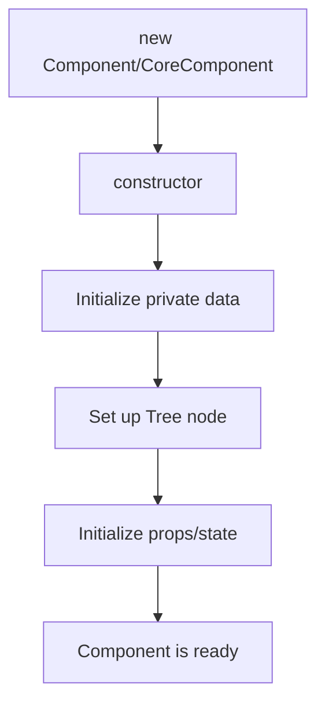

# Component Lifecycle

This document provides an in-depth explanation of the component lifecycle in the rendering system, focusing on both the CoreComponent and Component classes.

> **Note:** This document is part of a series on the rendering architecture. See also [Rendering Mechanism](../rendering/rendering-mechanism.md), [Scheduler System](./scheduler-system.md), and [Component Rendering Integration](./component-rendering-lifecycle.md).

## Overview

The component lifecycle consists of five main phases that each component goes through from creation to removal:

| Phase | Description |
|-------|-------------|
| Initialization | Component creation and setup |
| Mounting | First addition to the component tree |
| Updating | Processing state/props changes and rendering |
| Children Management | Creating and updating child components |
| Unmounting | Cleanup and removal from the tree |

## Lifecycle Phases

### 1. Initialization Phase



During initialization:
1. The component's constructor sets up private properties
2. The component is registered in the Tree structure
3. Initial props and state are established

`state` starts as `{}` and `context` as the parent's context (or `{}` without a parent), both typed
as the declared State/Context, so the types do not prove that required fields exist. Initialize
required state in the constructor, as in the [basic example](#basic-component).

### 2. CoreComponent Lifecycle

The CoreComponent provides the foundation with four main methods:

| Method | Purpose | When Called |
|--------|---------|-------------|
| `prepareUpdate()` | Applies pending data and reconciles children | Before painting for new or requested components; inside `iterate()` for clean visible ones |
| `iterate(prepared, visible)` | Updates unless `prepared`, then paints if `visible` and not vetoed | For visible components and prepared offscreen ones |
| `updateChildren()` | Defines and updates child components | During children update |
| `render()` | Handles visual rendering | During render phase |

> **Note:** For details on how these methods interact with the rendering pipeline, see [Rendering Mechanism](../rendering/rendering-mechanism.md).

### 3. Component Lifecycle Methods

The Component class extends CoreComponent with additional lifecycle hooks:

#### Method Sequence

Each layer tree first prepares new components and components that requested an update, then publishes
viewport visibility, then paints. New or requested components outside the viewport still prepare and
complete their update; clean offscreen components are skipped. A clean visible component prepares
inside its own `iterate()`, right before painting. Preparation is idempotent within an iteration,
including when `iterate()` is called directly.

Methods are called in this order:

1. First iteration only: `willMount()` runs inside `willIterate`, after `checkData`. State queued
   there is applied on the next iteration. Mounting does not depend on the first render.

2. Every Iteration:
   ```mermaid
   flowchart TD
       A[checkData] --> B[willIterate]
       B --> H{shouldUpdateChildren?}
       H -->|Yes| I[willUpdateChildren]
       I --> J[updateChildren]
       J --> K[didUpdateChildren]
       H -->|No| V[Tree's visible argument]
       K --> V
       V --> C{visible, shouldRender and isRenderAllowed?}
       C -->|Yes| D[willRender]
       D --> E[render]
       E --> F[didRender]
       C -->|No| G[willNotRender]
       G --> L[didIterate]
       F --> L
   ```

Children and geometry of new and requested components are prepared before the layer draws. Change
geometry through `setState()`, `setProps()` or `performRender()`: a change a clean component makes
inside its own update hook takes effect for culling from the next frame. Keep initialization, port
registration, and hit-box updates in constructors or update hooks: `willRender`, `render`, and
`didRender` are never called for a component whose known bounds are outside the viewport.
`firstRender` stays true until the component is actually painted; use `firstIterate` for mount-related
work. A visible child can be painted even when its parent's own bounds are offscreen.

### 4. State and Props Management

When state or props change:

| Step | Action | Method |
|------|--------|---------|
| 1 | Changes called | `setState()` or `setProps()` |
| 2 | Changes buffered | Stored in `__data` |
| 3 | Update scheduled | `performRender()` |
| 4 | Changes processed | `checkData()` |
| 5 | Callbacks triggered | `propsChanged()` or `stateChanged()` |
| 6 | Render evaluated | Based on the tree's `visible` argument, `shouldRender` and `isRenderAllowed()` |

### 5. Control Flags

Components use several boolean flags to control their behavior:

| Flag | Purpose | Default Value |
|------|---------|---------------|
| `firstIterate` | Tracks first iteration | `true` |
| `firstRender` | Tracks first render | `true` |
| `firstUpdateChildren` | Tracks first children update | `true` |
| `shouldRender` | Controls render() call | `true` |
| `shouldUpdateChildren` | Controls children updates | `true` |
| `shouldRenderChildren` | Explicitly allows or suppresses traversal of descendants | `true` |

## Examples

### Basic Component

```typescript
import { Component, TComponentProps } from "@gravity-ui/graph";

class MyComponent extends Component<TComponentProps, { counter: number }> {
  constructor(props: TComponentProps, parent?: Component) {
    super(props, parent);
    // Initial state must exist before the first render; setState is queued.
    this.state = { counter: 0 };
  }

  protected willMount() {
    // Subscribe here. setState called here applies on the next iteration, even while offscreen.
  }

  protected render() {
    console.log("Rendering with counter:", this.state.counter);
  }

  public increment() {
    this.setState({ counter: this.getState().counter + 1 });
  }
}
```

### Component with Children

```typescript
import { Component } from "@gravity-ui/graph";

class ParentComponent extends Component {
  protected updateChildren() {
    return [
      ChildComponent.create({ value: this.state.value }, { key: 'child1' }),
      AnotherChild.create({ data: this.props.data }, { key: 'child2' })
    ];
  }
  
  protected willUpdateChildren() {
    console.log('About to update children');
  }
  
  protected didUpdateChildren() {
    console.log('Children updated');
  }
}
```

## Best Practices

### Performance Optimization

1. Control rendering with lifecycle flags:
   ```typescript
   protected propsChanged(nextProps) {
     // Only render if relevant props have changed
     this.shouldRender = nextProps.value !== this.props.value;
   }
   ```

2. Batch state updates:
   ```typescript
   // Instead of multiple setState calls:
   // this.setState({ value: 1 });
   // this.setState({ count: 2 });
   
   // Batch updates in one call:
   this.setState({ value: 1, count: 2 });
   ```

> **Important:** Always clean up resources in the `unmount()` method to prevent memory leaks.
