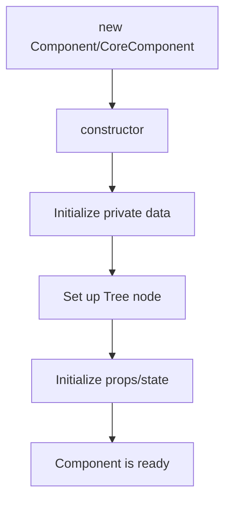

# Component Lifecycle

This document provides an in-depth explanation of the component lifecycle in the rendering system, focusing on both the CoreComponent and Component classes.

> **Note:** This document is part of a series on the rendering architecture. See also [Rendering Mechanism](../rendering/rendering-mechanism.md), [Scheduler System](./scheduler-system.md), and [Component Rendering Integration](./component-rendering-lifecycle.md).

## Overview

The component lifecycle consists of five main phases that each component goes through from creation to removal:

| Phase | Description |
|-------|-------------|
| Initialization | Component creation and setup |
| Mounting | First addition to the component tree |
| Updating | Processing state/props changes and rendering |
| Children Management | Creating and updating child components |
| Unmounting | Cleanup and removal from the tree |

## Lifecycle Phases

### 1. Initialization Phase



During initialization:
1. The component's constructor sets up private properties
2. The component is registered in the Tree structure
3. Initial props and state are established

`state` starts as `{}` and `context` as the parent's context (or `{}` without a parent), both typed
as the declared State/Context, so the types do not prove that required fields exist. Initialize
required state in the constructor, as in the [basic example](#basic-component).

### 2. CoreComponent Lifecycle

The CoreComponent provides the foundation with four main methods:

| Method | Purpose | When Called |
|--------|---------|-------------|
| `prepareUpdate()` | Applies pending data and reconciles children | Before painting for new or requested components; inside `iterate()` for clean visible ones |
| `iterate()` | Updates unless the tree already prepared the component, then paints if the tree decided so and nothing vetoes it | For visible components and prepared offscreen ones |
| `updateChildren()` | Defines and updates child components | During children update |
| `render()` | Handles visual rendering | During render phase |

> **Note:** For details on how these methods interact with the rendering pipeline, see [Rendering Mechanism](../rendering/rendering-mechanism.md).

### 3. Component Lifecycle Methods

The Component class extends CoreComponent with additional lifecycle hooks:

#### Method Sequence

Each layer tree first prepares new components and components that requested an update, then publishes
viewport visibility, then paints. New or requested components outside the viewport still prepare and
complete their update; clean offscreen components are skipped. A clean visible component prepares
inside its own `iterate()`, right before painting. Preparation is idempotent within an iteration,
including when `iterate()` is called directly.

Methods are called in this order:

1. First iteration only: `willMount()` runs inside `willIterate`, after `checkData`. State queued
   there is applied on the next iteration. Mounting does not depend on the first render.

2. Every Iteration:
   ```mermaid
   flowchart TD
       A[checkData] --> B[willIterate]
       B --> H{shouldUpdateChildren?}
       H -->|Yes| I[willUpdateChildren]
       I --> J[updateChildren]
       J --> K[didUpdateChildren]
       H -->|No| V[Tree's paint decision]
       K --> V
       V --> C{visible, shouldRender and isRenderAllowed?}
       C -->|Yes| D[willRender]
       D --> E[render]
       E --> F[didRender]
       C -->|No| G[willNotRender]
       G --> L[didIterate]
       F --> L
   ```

Children and geometry of new and requested components are prepared before the layer draws. Change
geometry through `setState()`, `setProps()` or `performRender()`: a change a clean component makes
inside its own update hook takes effect for culling from the next frame. Keep initialization, port
registration, and hit-box updates in constructors or update hooks: `willRender`, `render`, and
`didRender` are never called for a component whose known bounds are outside the viewport.
`firstRender` stays true until the component is actually painted; use `firstIterate` for mount-related
work. A visible child can be painted even when its parent's own bounds are offscreen.

### 4. State and Props Management

When state or props change:

| Step | Action | Method |
|------|--------|---------|
| 1 | Changes called | `setState()` or `setProps()` |
| 2 | Changes buffered | Stored in `__data` |
| 3 | Update scheduled | `performRender()` |
| 4 | Changes processed | `checkData()` |
| 5 | Callbacks triggered | `propsChanged()` or `stateChanged()` |
| 6 | Render evaluated | Based on the tree's paint decision, set on the node right before `iterate()`, `shouldRender` and `isRenderAllowed()` |

### 5. Control Flags

Components use several boolean flags to control their behavior:

| Flag | Purpose | Default Value |
|------|---------|---------------|
| `firstIterate` | Tracks first iteration | `true` |
| `firstRender` | Tracks first render | `true` |
| `firstUpdateChildren` | Tracks first children update | `true` |
| `shouldRender` | Controls render() call | `true` |
| `shouldUpdateChildren` | Controls children updates | `true` |
| `shouldRenderChildren` | Explicitly allows or suppresses traversal of descendants | `true` |

### 6. Retained Components

A class that declares `static override readonly mode = "retained"` is not walked by the frame. It is created, updated and unmounted by
its parent and receives context, but never `iterate()`, `render()`, `willRender()`, `didRender()`, `willNotRender()`,
`didIterate()` or `viewportChanged()`. `performRender()` (and so `setState()` / `setProps()`) queues it; the tree
applies the queue before painting, running `checkData()`, `willIterate()` (`willMount()` first) and the children
lifecycle: a culled tree after preparing its walked components, a tree without culling before the walk and again
right after a parent reconciles retained children. A component applies once per frame, and once more after each
reconciliation by its parent in that frame, so props from a reconciliation are not a frame late; what it requests
during its own update applies in the next frame. Children of a retained component must be retained; a root cannot
be. In development builds a retained class with per-frame hooks logs a warning. Connection components
(`BlockConnection`) are retained. Retained components draw clickable regions as child components (see
[Block component](../components/block-component.md#child-components)).

### 7. Scene Components

A `SceneComponent` (the canvas `Block` and `Anchor`) is a retained component that [the scene](scene.md) draws. Its
element is written in its queued update:

1. **Trigger.** In `willMount()` it creates a `computed` of its view data (`getViewData()`), its origin
   (`getSceneOrigin()`), its bucket (`getSceneZIndex()`) and an invalidation counter. When one of them changes (a
   store signal it reads, new props, `invalidate()`), it calls `performRender()`, which queues its update. `setState()`
   and `setProps()` queue it too.
2. **Update.** In the frame, before painting, the tree applies the queued update: `checkData()`, then `willIterate()`,
   which writes the element. The level methods run there, lazily: only when the view data changed or after `invalidate()`
   (normally once per frame; a parent's reconciliation can apply it again in the same frame, and an export can apply
   it outside a frame). A move writes the origin only, and level output equal to the last one re-encodes nothing.
   The hidden state (`isSceneHidden()`, and the handover: `isRenderDelegated()`) and the parent (`getSceneParent()`)
   are read in the update itself, so a change of them must call `performRender()`.
3. **Children.** The children update after their parent, so a child element (an anchor's, a child component's) is
   written after its parent element exists. A child whose parent element is missing writes nothing and logs an error.

`willMount()` must call `super.willMount()`, which creates the computeds; without it the element is never written, and
development builds log an error. `invalidate()` from `stateChanged()` has no effect when the view data reads component
state: the view data is recomputed at once, before the new state is assigned. Call it in `willIterate()`, before
`super.willIterate()`. A scene component with `static override readonly mode = "immediate"` (such as `LegacyCanvasBlock`) is walked: its
update runs in every frame and writes its element only when an input changed.

## Examples

### Basic Component

```typescript
import { Component, TComponentProps } from "@gravity-ui/graph";

class MyComponent extends Component<TComponentProps, { counter: number }> {
  constructor(props: TComponentProps, parent?: Component) {
    super(props, parent);
    // Initial state must exist before the first render; setState is queued.
    this.state = { counter: 0 };
  }

  protected willMount() {
    // Subscribe here. setState called here applies on the next iteration, even while offscreen.
  }

  protected render() {
    console.log("Rendering with counter:", this.state.counter);
  }

  public increment() {
    this.setState({ counter: this.getState().counter + 1 });
  }
}
```

### Component with Children

```typescript
import { Component } from "@gravity-ui/graph";

class ParentComponent extends Component {
  protected updateChildren() {
    return [
      ChildComponent.create({ value: this.state.value }, { key: 'child1' }),
      AnotherChild.create({ data: this.props.data }, { key: 'child2' })
    ];
  }
  
  protected willUpdateChildren() {
    console.log('About to update children');
  }
  
  protected didUpdateChildren() {
    console.log('Children updated');
  }
}
```

## Best Practices

### Performance Optimization

1. Control rendering with lifecycle flags:
   ```typescript
   protected propsChanged(nextProps) {
     // Only render if relevant props have changed
     this.shouldRender = nextProps.value !== this.props.value;
   }
   ```

2. Batch state updates:
   ```typescript
   // Instead of multiple setState calls:
   // this.setState({ value: 1 });
   // this.setState({ count: 2 });
   
   // Batch updates in one call:
   this.setState({ value: 1, count: 2 });
   ```

> **Important:** Always clean up resources in the `unmount()` method to prevent memory leaks.
