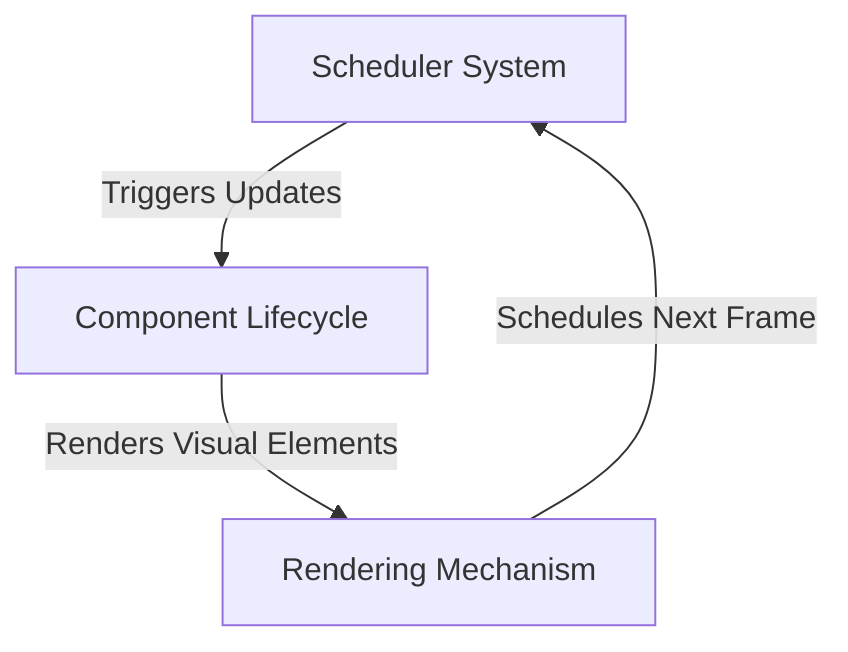
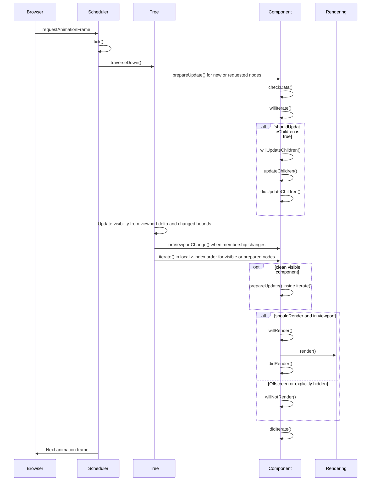

# Component Rendering and Lifecycle Integration

This document provides a comprehensive view of how the component lifecycle, rendering mechanism, and scheduler system work together to create the complete rendering pipeline.

## Architectural Overview

The rendering system consists of three interconnected subsystems:



Each subsystem has a specific responsibility:
- **Scheduler System**: Coordinates when updates happen using animation frames
- **Component Lifecycle**: Manages component state, updates, and child components
- **Rendering Mechanism**: Handles the actual visual representation of components

## Integrated Update Flow

The following sequence diagram shows how these systems interact during a typical update cycle:



## Key Integration Points

### 1. Component Updates and Scheduler

When a component's state or props change:

1. `Component.setState()` or `Component.setProps()` is called
2. `performRender()` schedules an update with the `Scheduler`
3. The `Scheduler` marks the component tree for update
4. On the next animation frame, the `Scheduler` traverses the component tree
5. The tree prepares the requested component, new components and their ancestors
6. The tree publishes viewport visibility, then `iterate()` updates and paints visible components and completes prepared offscreen updates

From `scheduler-system.md`:
> Component calls `performRender()` to schedule an update. This method sets the `scheduled` flag in the component's `Scheduler` instance, indicating that the component tree needs to be updated.

The pending node remains eligible for preparation even outside the viewport, so spatial culling does
not discard state or props updates.

### 2. Component Lifecycle and Rendering

The component lifecycle controls the rendering process through several key methods:

1. `prepareUpdate()` - Applies data and reconciles children; before painting for requested and new components, inside `iterate()` for clean visible ones
2. `checkData()` - Processes any pending state/props changes
3. `shouldRender` flag and `isInViewport()` - Together control whether rendering occurs
4. `iterate()` / `render()` - Complete the update and create eligible visual output
5. `shouldUpdateChildren` flag - Controls whether children are updated

See [Component Lifecycle](./component-lifecycle.md) for the hook order and the distinction between
`firstIterate` and `firstRender`.

### 3. Tree Structure and Z-Index

All three systems interact with the Tree structure, which:
- Maintains the parent-child relationships between components
- Manages the z-index ordering for proper rendering
- Provides traversal methods for the scheduler
- Owns one `TileIndex` per layer root, shared by every descendant

The layer supplies its camera's world-space viewport; Tree and Scheduler do not depend on Camera.
Each component reports its own bounds. The tree keeps the published visible set between frames and
rechecks only nodes that a camera move or a bounds change can affect. A visible child is reached through
a clean offscreen parent without running the parent's hooks, so an offscreen parent does not hide a
visible child. Unknown bounds remain eligible. New and requested offscreen nodes still update, but never
enter the painting lifecycle. Setting
`shouldRenderChildren` to false explicitly suppresses a branch, independently of spatial culling.

Visibility changes are published before the layer paints, allowing connection batches to invalidate
affected chunks before drawing. Both the component lifecycle and batch renderer use the same published
visibility. Hit testing retains its separate spatial index and supports queries outside the viewport.

From `scheduler-system.md`:
> During an update, the Scheduler traverses the component tree in depth-first order: Tree._walkDown, Iterator returns true/false, Process/Skip children

From `rendering-mechanism.md`:
> The rendering mechanism is built upon a hierarchical tree structure with the following key components: Tree - The base hierarchical structure that manages parent-child relationships with z-index ordering

## Complete Rendering Lifecycle

Combining all three documents, we can map the complete lifecycle from state change to screen update:

1. **State/Props Change**
   - Component calls `setState()` or `setProps()`
   - Changes are buffered in the component's `__data`
   - Component calls `performRender()`

2. **Scheduling**
   - Scheduler sets the `scheduled` flag
   - GlobalScheduler manages animation frame timing
   - On the next frame, scheduler traverses the component tree

3. **Preparation**
   - Component's `prepareUpdate()` method is called: before painting when the component is new or
     requested an update, otherwise inside its own `iterate()` when it is visible
   - `checkData()` processes buffered state/props changes
   - `propsChanged()` or `stateChanged()` handle specific changes
   - `willIterate()` runs, including `willMount()` on the first iteration
   - If `shouldUpdateChildren` is true, children are reconciled
   - For requested components, the tree publishes the resulting bounds before anything paints

4. **Rendering Decision**
   - Component evaluates `shouldRender` and the tree's published viewport visibility
   - If true: `willRender()` → `render()` → `didRender()`
   - If false: `willNotRender()`

5. **Completion**
   - `didIterate()` finalizes the component update
   - Scheduler moves to the next component or completes the frame
   - Browser renders the updated view
   - Process repeats on the next animation frame if needed

## Performance Optimization Strategies

Leveraging all three systems, developers can optimize performance:

1. **Control rendering with lifecycle flags**
   ```typescript
   protected propsChanged(nextProps) {
     // Only render if relevant props have changed
     this.shouldRender = nextProps.value !== this.props.value;
   }
   ```

2. **Skip child updates when not needed**
   ```typescript
   protected stateChanged(nextState) {
     // Only update children if specific state changed
     this.shouldUpdateChildren = nextState.items !== this.state.items;
   }
   ```

3. **Use z-index for optimal rendering**
   ```typescript
   // Set z-index for proper rendering order
   this.zIndex = 5; // Higher z-index components render on top
   ```

4. **Use scheduler priority levels for extra frame work**
   ```typescript
   // Components are updated by their graph; register only additional per-frame work
   const removeTask = graph.scheduler.addScheduler(
     { performUpdate: () => updateOverlay() },
     ESchedulerPriority.LOW,
   );
   ```

## Debugging and Troubleshooting

When debugging rendering issues, consider these cross-system approaches:

1. **Lifecycle Method Logging**
   - Add logs to component lifecycle methods to track execution
   - Check if expected methods are called in the right order

2. **Scheduler State Inspection**
   - Verify that updates are being scheduled
   - Check if component tree traversal is working correctly

3. **Render Performance Profiling**
   - Track time spent in render methods
   - Identify components that render unnecessarily

4. **Tree Structure Validation**
   - Ensure parent-child relationships are correct
   - Verify z-index ordering matches expectations

## Summary

The component lifecycle, rendering mechanism, and scheduler system are deeply interconnected:

- **Component Lifecycle** provides the methods and hooks that control component behavior
- **Rendering Mechanism** handles the visual representation and component structure
- **Scheduler System** coordinates when updates happen and how the tree is traversed

Understanding these connections is essential for effectively using and extending the graph visualization library.

## Related Documentation

- [Component Lifecycle](./component-lifecycle.md) - In-depth details about component lifecycle methods
- [Rendering Mechanism](../rendering/rendering-mechanism.md) - Architectural details of the rendering system
- [Scheduler System](./scheduler-system.md) - Explanation of the scheduling and update system
