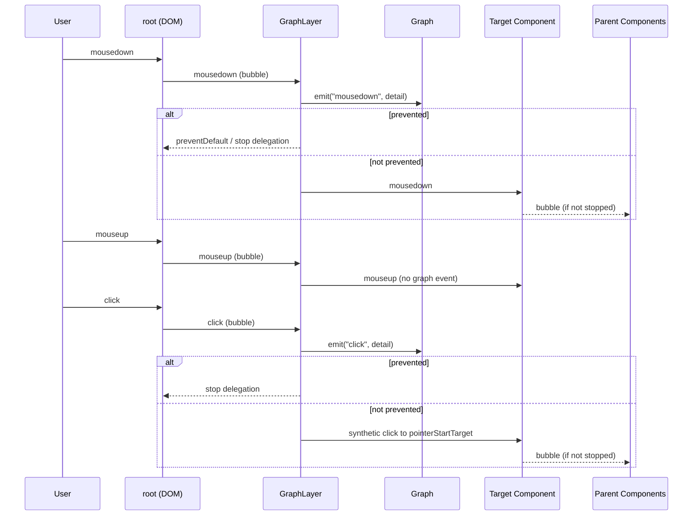

## Event Model in @gravity-ui/graph

This is a strictly technical document that details the event model implementation, based on `GraphLayer` and
`EventedComponent`. It explains the listener phases, click emulation, and subtle behaviors that affect reliability
and performance. The document also covers how layers with CSS `pointer-events` other than `none` impact event
delivery.

See also: `docs/system/events.md` for a high-level overview.

### Terms and Actors

- **Graph** — central event emitter at the graph level, with `emit` and event types defined in `src/graphEvents.ts`.
- **GraphLayer** — the layer that:
  - Subscribes to DOM events on the graph `root` element.
  - Performs hit‑testing in camera space to determine the target component.
  - Emits graph‑level events (`graph.emit`) and delegates DOM events into the canvas component tree.
- **EventedComponent** — base component class that supports subscriptions and dispatch with custom bubbling over the component tree.

### Event Flow (high level)

1. A DOM event arrives at `root`.
2. `GraphLayer` intercepts it (in the bubbling phase), recomputes the current target from camera‑space coordinates,
   and updates gesture state (e.g., whether a button is pressed).
3. `GraphLayer` may first emit a graph event via `graph.emit(eventName, { target, sourceEvent, pointerPressed })`.
   - If any graph handler calls `event.preventDefault()`, delegation into components is aborted (see `dispatchNativeEvent`).
   - For `mousedown`, the camera pan and `DragService` are default actions: `graph.emit` runs them after all graph handlers, and only when none prevented the event. Preventing it stops both, whenever the handler subscribed. Handlers therefore never see the event already prevented by the camera.
4. If not prevented, `GraphLayer` delegates the original or a synthetic event into the canvas component tree via `target.dispatchEvent(event)`.
5. `EventedComponent` processes the event, including custom bubbling to parents until `stopPropagation` is invoked.



### Role of GraphLayer: what the layer actually does

Key points from `GraphLayer`:

- Registers listeners on `root`:
  - In the bubbling phase: `mousedown`, `touchstart`, `mouseup`, `touchend`, `click`, `dblclick`, `contextmenu`, and
    `mousemove`.
  - No capture-phase listener: the capture list (`rootCapturingEventTypes` in `GraphLayer.ts`) is commented out.
  - `mouseleave` of the root: the pointer left the graph, and the target becomes none.
- Tracks `targetComponent` and `prevTargetComponent`.
- On `mousemove`, when target changes, synthesizes hover semantics (see
  [The model](#the-model-events-walk-up-the-component-tree)):
  - For the previous target: `mouseleave` and `mouseout`.
  - For the new target: `mouseenter` and `mouseover`.
  - Each walks the parent chain of its target, and each carries `detail.relatedTarget`, the other side of the change.
- Tracks `pointerPressed` and supports explicit capture via `captureEvents/releaseCapture`.
- Emulates click and double click (`tryEmulateClick`) to deliver them to the start target.

```
[mousemove]
  target changed?
    yes ->
      prevTarget <- mouseleave (walks the parent chain; only if there is a prevTarget)
      prevTarget <- mouseout   (walks the parent chain; only if there is a prevTarget)
      newTarget  <- mouseenter (walks the parent chain; only if there is a newTarget)
      newTarget  <- mouseover  (walks the parent chain; only if there is a newTarget)
```

#### Listener phases

GraphLayer listens on `root` in the bubbling phase only. An event reaches it after the handlers of the elements inside
`root` (HTML blocks, overlays) have run. A handler there that stops an event's propagation hides it from the graph: a
stopped `mousedown` or `mouseup` is a gesture start or end the graph never sees, and a stopped `click` is a click no
canvas component gets.

### EventedComponent model: internal dispatch

`EventedComponent` implements a lightweight event model with custom bubbling up the component tree:

- Each component keeps a map of listeners by event type.
- `dispatchEvent(event)` walks from the component up its parent chain, whatever `event.bubbles` says. At each
  component:
  - its `onDispatchedEvent(event)` hook runs, whatever its interactivity (the library `Block` and `Anchor` follow hover
    there);
  - then its listeners for `event.type` run, unless it is not interactive (`interactive: false`).
- The walk ends when a listener calls `stopPropagation()`.

Bottom line: local handlers do not consume events automatically; call `stopPropagation` explicitly to stop further propagation.

A class that overrides `dispatchEvent` to fire its own listeners without the walk skips its own `onDispatchedEvent`
too. Call `this.onDispatchedEvent(event)` first in such an override, or the library `Block`'s hover stops following
the pointer over its body.

#### Child components

A scene component returned from another one's `updateChildren()` is a hit-test target of its own, ordered with its
parent in the scene: children above their parent, in the pre-order of their nesting. Its events bubble to its parent
through the parent walk. See [Block component](../components/block-component.md#child-components).

#### The model: events walk up the component tree

- A component the pointer is on handles its event and lets it go on, or stops it.
- An event it does not stop walks to its parent, its parent's parent and on. Each ancestor can check the target
  (`getEventTarget(event)`, below) and decide.
- On a target change GraphLayer fires `mouseleave` and `mouseout` at the old target, then `mouseenter` and
  `mouseover` at the new one, each walking the parent chain.
- Only the sides that exist get them: entering the graph sends no leave, and leaving it sends no enter.
- Their `detail.target` is the side they are fired at. Their `detail.relatedTarget` names the other side of the
  change, none for the camera or outside the graph. A parent tells from it whether the pointer stayed in its subtree.
- The graph's own `mouseenter` and `mouseleave` (`graph.on`, `useGraphEvent`) go out at the same moments, before the
  components get theirs, with the same targets and `relatedTarget` (`GraphMouseEvent.detail.relatedTarget`). The
  CursorLayer follows them.
- One target change is one signal batch, so a block whose pointer moves onto its anchor is never drawn un-hovered.

**Retargeting under a still pointer.** When what a still pointer hits changes, GraphLayer finds the target again and
fires the same leave and enter. It does so at the end of the graph frame, or once the hit test has indexed that
frame's hit boxes when they still wait in its queue, or at the release of a drag, after:

- a component hidden, shown or unmounted. An unmounted target gets no event: the nearest graph component above it
  becomes the old side of the next change, unless the pointer is on that one, so it gets the `mouseleave` once the
  pointer is no longer on it;
- a hit box that was set before moving, resizing, going or coming back (a block or an anchor moved through the API, a
  child's look). A component's first hit box asks nothing: a component that mounts under the pointer is found at the
  next pointer move;
- a child's hit levels changing;
- an HTML hold taken or released (`delegateRender`);
- a scene level change. This retargets even with `emulateMouseEventsOnCameraChange` off: a wheel zoom from the
  minimalistic level into the schematic one over an anchor makes the anchor the target without a pointer move.

A hit box whose size follows the camera asks for no retarget: a connection stroke whose width is in screen pixels
calls `invalidateLine({ followsCamera: true })` (or `ConnectionLine.invalidate({ followsCamera: true })`) on zoom.
Camera moves keep the `emulateMouseEventsOnCameraChange` rule. A pointer that leaves the graph changes the target to
none, and a camera move then finds no target. While graph-react's blocks list mounts the views of the detailed level,
a retarget waits for them, at most three graph frames.

#### The hit target: `getEventTarget`

`getEventTarget(event)` returns the graph component a pointer event hit, the one GraphLayer dispatched it to: a block,
an anchor, a child component, a connection or a group. That is the component under the pointer, the captured one
during a gesture, and for a click or a dblclick the one the press started on. It is the same in every handler along
the parent walk, and after the dispatch. `getEventTarget(event, Class)` returns it only when it is an instance of
`Class`. It is `undefined` for the camera (empty space), for other events, and for an event dispatched straight at a
component with `component.dispatchEvent(event)`.

- The events stay native. `click`, `mousedown`, `mouseup` and `dblclick` are the browser's `MouseEvent`s, with their
  modifiers and coordinates. An emulated click is a copy of the browser's event, and its DOM `target` is `null`.
- Only the hover events (`mouseenter`, `mouseleave`, `mouseover`, `mouseout`) are `CustomEvent`s, with
  `detail.target`, `detail.relatedTarget`, `detail.sourceEvent` and `detail.pointerPressed` (`TGraphHoverDetail`).
- On the graph's bus, `detail.target` names the target, and `getEventTarget(detail.sourceEvent)` returns it as a graph
  component. The bus event itself is not dispatched to components, so `getEventTarget` of a bus `click` is
  `undefined`.
- A press that a drag or the camera's pan takes reaches no component (see [Presses and drags](#presses-and-drags)).
  The bus's `mousedown` still names the target.

```typescript
import { CanvasBlock, getEventTarget } from "@gravity-ui/graph";
import type { Graph } from "@gravity-ui/graph";

declare const graph: Graph;

// On the bus: what the last click hit, also when that component stopped the click.
graph.on("click", (event) => {
  const target = getEventTarget(event.detail.sourceEvent);
  if (target instanceof CanvasBlock) console.log("a click on block", target.getEntityId());
});
```

#### Presses and drags

A press goes to the graph's bus first. The camera's pan and `DragService` are the default actions of the graph's
`mousedown`: they run after every graph listener, and only when none prevented the event. They decide by the press's
drag target, as in the DOM:

- The drag target is the pressed component when it is draggable (`isDraggable()`), else its nearest draggable
  ancestor. So a press on a child button inside a draggable block drags the block. Only graph components count: the
  blocks container, the layer and the camera are passed over.
- When there is a drag target, the camera does not pan. `DragService` drags it while `canDrag` allows it (`ALL`, or
  `ONLY_SELECTED` with the component selected), and then takes the press. Otherwise (`canDrag: NONE`, the default)
  nothing is dragged and the press reaches the components. A block is draggable only while `canDrag` allows it, so
  with the defaults a press on a block or its child pans the camera.
- When nothing in the chain is draggable, the camera pans (`canDragCamera`, an unmodified left press) and takes the
  press. Ctrl or Meta skips the pan. A middle-button press without Ctrl or Meta pans whatever it is on, while
  `canDragCamera` is on.
- A press that a drag or the pan takes reaches no component: neither the pressed child nor its block gets the
  `mousedown`. The `mouseup` still reaches the component under the pointer. The `click` reaches the pressed component
  when the release is over it and less than 3 px from the press.

A child with a gesture of its own takes the press first, in one of two ways:

- It makes itself draggable: `isDraggable()` returns true, and `handleDragStart`, `handleDrag` and `handleDragEnd` do
  the gesture, as `Anchor` does (it forwards them to its block). `DragService` drags it while `canDrag` allows it.
- A graph `mousedown` listener prevents the press and starts the gesture with `graph.dragService.startDrag`.
  Preventing the press stops the block's drag and the camera's pan, and keeps the `mousedown` from every component,
  the child included:

```typescript
import { GraphComponent, getEventTarget } from "@gravity-ui/graph";
import type { Graph } from "@gravity-ui/graph";

declare const graph: Graph;

/** A slider's knob inside a block, with a drag of its own. */
class Knob extends GraphComponent {
  public value = 0;
}

graph.on("mousedown", (event) => {
  const knob = getEventTarget(event.detail.sourceEvent, Knob);
  if (!knob) return;
  // Not the block's drag, nor the camera's pan.
  event.preventDefault();
  graph.dragService.startDrag({
    onUpdate: (_moveEvent, [x]) => {
      knob.value = x;
    },
  });
});
```

`GraphComponent.onDrag()` listens to the component's own `mousedown`, so it runs only for a press that neither a drag
nor the camera's pan takes. Under a draggable block, the block's drag takes a child's press, so a child's `onDrag`
never starts; use one of the two ways above.

#### Hover styles

`hoveredTag` is a styling tool that components put on themselves (`setHoveredTag`). The library `Block` does it while
the pointer is on it or on a descendant. `Anchor`, connections and groups do it while they are the target. No library
code reads a tag to decide behaviour. A graph `mouseenter` or `mouseleave` handler that calls `preventDefault()` keeps
that event from the components, so a component that writes `hoveredTag` from it keeps its old tag: a prevented
`mouseleave` leaves the block or anchor tagged.

#### Transparent components

`static transparentToEvents = true` lets pointer events pass through a component that has a hit box: the pointer's
target, its hover events, the cursor and `graph.getElementOverPoint()` skip it for the component under it. Its hit box
stays: it counts in the usable rect, and `getElementsOverPoint()` and `getElementsOverRect()` return it. See
[Transparent components](../components/canvas-graph-component.md#transparent-components).

#### Hit levels

A scene component is hit on the levels where it is shown:

- an element owner (a block) on every level;
- a child (an anchor, a child component) on the levels its look is drawn on, and wherever its block is shown outside
  the scene (at the detailed level while an HTML view holds the block, on every level after `setRenderDelegated(true)`);
- a child without a look only on the levels its class declares.

`static hitLevels` on a class overrides this rule for each of its components, a block included: its components are
hit on the declared levels only, even while an HTML view holds the block. `getElementOverPoint()`,
`getElementsOverPoint()` and `getElementsOverRect()` leave out what the level does not hit.

**Hidden components.** A scene component hidden for a reason other than the handover (`setVisibility(false, …)`, a
collapsed group, an `isSceneHidden()` override) is a barrier for its descendants: none of them is hit, on any level,
as under `display: none` in the DOM. A hidden child is not hit either. A hidden element owner (a block) is not hit
once its hit box is removed: `setVisibility(false, { removeHitbox: true })` removes it, and so does a collapsed group
(`setHiddenBlock`). With `removeHitbox: false` the owner keeps its hit box and stays a target. The handover is no such
reason: a block held by an HTML view or delegated with `setRenderDelegated(true)` is hit, and so are its children.

### How a click on an element works (step by step)

Scenario for a typical left‑click where press and release occur nearly at the same spot:

1. `mousedown` (bubbling, on the graph root):
   - `GraphLayer` sets `pointerPressed = true`.
   - Computes `targetComponent` (or uses the captured target if `captureEvents` was used).
   - Stores `pointerStartTarget` and the DOM event as `pointerStartEvent`.
   - Proxies the native `mousedown` to the target (after graph emit and default prevention check).
2. `mouseup` (bubbling, on the graph root):
   - `GraphLayer` sets `pointerPressed = false`.
   - Verifies that:
     - Current target equals the start target OR both are `BlockConnection` (connections can be very close), and
     - Pointer delta `getEventDelta(pointerStartEvent, mouseup) < 3`.
   - If satisfied, marks `canEmulateClick = true`.
   - Proxies `mouseup` to the target.
3. `click` (bubbling):
   - If `canEmulateClick === true`, `GraphLayer` creates a new `MouseEvent("click")` and DELIVERS it to `pointerStartTarget` (not the current target!).
   - First, a graph event `click` is emitted; if any handler calls `preventDefault()`, delegation into components is skipped.
   - Otherwise, the event is dispatched into components (`EventedComponent.dispatchEvent`).
4. `dblclick` follows the same logic and is delivered to the start target.

The click is intentionally bound to the start target, not to the current pointer target, to avoid misses from tiny pointer drift and to keep `BlockConnection` interactions reliable.

```
Down (bubble)     Up (bubble)             Click (bubble)
   |                 |                        |
   v                 v                        v
  mark start ----> mark canEmulateClick? --> deliver synthetic click
      \________ same target OR both BlockConnection _______/
                 AND getEventDelta(start, up) < 3
```

### Impact of layers with `pointer-events` ≠ `none`

By default, the canvas layer is marked with `no-pointer-events` (`pointer-events: none`) to avoid becoming a DOM target that blocks other layers. What if a top layer uses `pointer-events: auto`?

- Every pointer event `GraphLayer` handles is subscribed in the bubbling phase. Events on an HTML overlay inside
  `root` bubble to `root`, and GraphLayer targets the component under the pointer.
- If a top layer calls `stopPropagation()` on such an event, `GraphLayer` never receives it and won't delegate it into
  canvas components: a stopped press or release breaks the gesture, and a stopped click is lost.
- If a top layer uses portals with handlers outside the graph `root`, events might never enter the `root` subtree — then `GraphLayer` won't see them.

Recommendations:

- For overlays, keep `pointer-events: none` by default and enable `pointer-events: auto` only where DOM interactivity is required.
- Avoid unconditional `stopPropagation()` on top layers if the graph must keep receiving presses, releases and clicks.
- If you need to block clicks for the graph, do it deliberately and locally.

### Click emulation and top layers

- Clicks are emulated (`tryEmulateClick`) from the press and the release: the component gets a copy of the browser's
  `click`, at the press's target.
- Top layers handle a click before the graph, because GraphLayer listens in the bubbling phase. They can block it for
  the graph by stopping its propagation.

### Interaction between graph events and component delegation

Before delegating a DOM event into components, `GraphLayer` emits a graph event (e.g., `click`, `mousedown`, `mouseenter`). If any graph handler calls `preventDefault()`, `GraphLayer` calls `event.preventDefault()` on the original event and does NOT delegate into components. This enables centralized control at the app level (e.g., disable clicks, intercept drag start).

The same holds for `mouseenter` and `mouseleave`, and components write their `hoveredTag` from those events (see
[Hover styles](#hover-styles)).

### Practical guidelines

- Use `Graph` handlers for cross‑component logic (selection, global hotkeys, cancellations).
- Use `EventedComponent` handlers for local component behavior.
- Stop propagation deliberately: at the `Graph` level via `preventDefault` (to block delegation), at components via `stopPropagation`.
- When designing HTML overlays, validate how `pointer-events` and `stopPropagation` affect `click/dblclick/contextmenu` delivery.

### TL;DR

- GraphLayer listens on `root` in the bubbling phase only; an element inside `root` that stops an event hides it from
  the graph.
- Click is emulated and delivered to the start target (`pointerStartTarget`) if pointer drift is small.
- `Graph.emit` can prevent further delegation into components via `preventDefault()`.
- Top layers with `pointer-events: auto` can swallow `click/dblclick/contextmenu`; avoid unconditional `stopPropagation` or allow events to reach the graph `root`.
- Every pointer event walks the parent chain of its target until a listener stops it; `getEventTarget(event)` names
  the target in every handler.
- Pointer targeting skips components transparent to events and scene components the level does not show.


